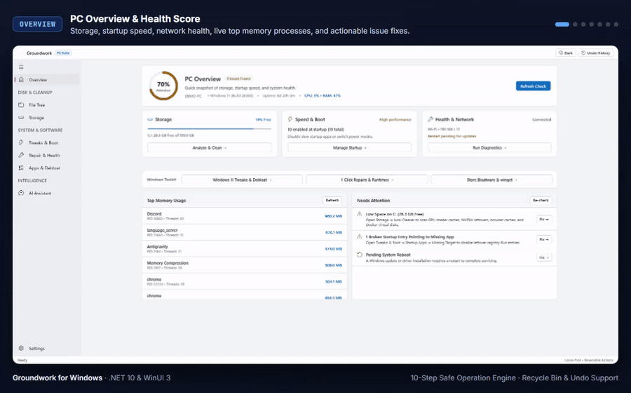

# Groundwork

<p align="center">
  
</p>

<p align="center">
  <strong>Native Windows Utility, System Tweaker, Repair Toolkit &amp; Local-First Storage Forensics</strong>
</p>

<p align="center">
  <a href="https://github.com/ttnhan227/Groundwork/actions/workflows/release.yml"></a>
  
  
  
</p>

<p align="center">
  
</p>

---

## 📌 Overview & Core Promise

**Understand your PC. Investigate problems. Optimize with confidence. Maintain control.**

**Groundwork** is a native Windows system companion built with **C#, .NET 10, and WinUI 3** that helps users understand their computers, investigate problems, optimize Windows, and perform safe maintenance through a unified desktop application:

1. **Overview & Quick Action Center**: Real-time Windows 10/11 hardware, disk, startup, network, and pending-reboot snapshot with honest health scoring, live issue advisories, and direct launchers into tweaks, repairs, and debloating.
2. **Storage (Space Map, Junk Cleaner, Tidy Folder & Duplicate Finder)**:
   - Parallel Win32 `FindFirstFileExW` directory walker with interactive folder-tree expansion and largest-files Recycle Bin actions.
   - Deep **Space-Hog Forensics** (`StorageHotspotAnalyzerService`) separating safe regenerable caches (NVIDIA `DXCache`/`GLCache`/`ota-artifacts`, `D3DSCache`, multi-profile Chromium/Firefox browser caches, NuGet/npm/Bun/pip/VS Code caches) from protected WSL/Docker `.vhdx` disks.
   - 3-stage SHA-256 duplicate finder (with NTFS hard-link & cloud-placeholder protection) and reversible **Tidy Folder** organizer with 1-click Undo.
3. **Tweaks & Boot (Windows 11 Power Tweaks, Presets, Power Mode & Startup)**:
   - Reversible hidden Windows 11/10 tweaks: **Classic Windows 10 Right-Click Menu**, **Disable Bing Web Search in Start Menu**, **Block Windows Ads/Tips/Lock Screen Promos**, **Taskbar Right-Click End Task**, **Hide Widgets/Copilot**, **Show Seconds in Clock**, and **Disable Mouse Acceleration (Raw 1:1 Pointer)** — individually or via **1-Click Presets** (*Clean Win11 & Debloat*, *Gaming & Raw Mouse*) with **Restart File Explorer**.
   - Power Plan switcher with **Ultimate Performance** scheme unlock and Administrator-gated **Hibernation (`hiberfil.sys`)** toggle to reclaim SSD space.
   - Multi-scope Startup entry inspector (`HKCU`/`HKLM`/Startup folders/Scheduled Tasks) with broken-target filtering and reversible toggles.
4. **Repair & Health (1-Click Repair Toolkit, Runtime Health, Network & Event Logs)**:
   - Token-gated repair workflows: **Rebuild Icon & Thumbnail Cache + Restart Explorer**, **Full Network & Winsock Reset**, **Clear Stuck Print Spooler**, **Reset Stuck Windows Update Cache**, **DISM `WinSxS` Component Cleanup**, and **`sfc /scannow`**.
   - **App & Game Runtime Health** audit for Visual C++ 2015–2022 (`x64`/`x86`), `.NET Desktop Runtime`, and `Edge WebView2 Runtime`.
   - Active network diagnostics (`ipconfig`/Ping/DNS/1-click Cloudflare/Google/Quad9/DHCP DNS switcher), Hardware/SMBIOS specs, Event Log error explanations, and structured **Groundwork Investigations**.
5. **Apps & Debloat (Store UWP Bloatware, Win32 Uninstaller & `winget` Batch Setup)**:
   - Preinstalled Microsoft Store (`Appx`) bloatware scanner with strict protection blocking removal of core Windows Store, terminal, and UI frameworks.
   - Win32 installed-software manager with native icon extraction, uninstaller launch, and Recycle Bin leftover cleanup.
   - Curated **Essential Runtimes & Clean Utilities (`winget`)** batch installer (VC++ x64/x86, `.NET 10 Desktop`, `7-Zip`, `Everything`, `PowerToys`, `WizTree`, `VLC`).
6. **Optional System-Aware AI Assistant**: Backed by `ToolRegistryService` (`27` typed local tools) and `AgentPlannerService` — works offline deterministically or connects to local `Ollama` and cloud LLMs (`Gemini`, `OpenAI`, `Anthropic`, `Mistral`, `Custom`) using DPAPI-encrypted credentials.

---

## 🛡️ Safe Operation Framework (10-Step Lifecycle)

Every modifying action in Groundwork passes through `SafeOperationEngine` and `PolicyEngine`:
1. **Inspect** current system state
2. **Validate** prerequisites and elevation boundaries
3. **Capture** original state (`PreChangeStateJson`)
4. **Explain** the proposed change in plain language
5. **Display** potential risks, affected targets, and reversibility (`ReadOnly`, `Reversible`, `PartiallyReversible`, `Irreversible`)
6. **Request Approval** via a single-use, time-bounded confirmation token
7. **Execute** the operation using explicit Win32/Registry/process APIs (never arbitrary shell strings)
8. **Verify** the actual resulting system state
9. **Record** the execution and verification outcome in `OperationHistoryService`
10. **Provide Recovery / Rollback** with one click

---

## 🛠️ Building & Testing from Source

### Prerequisites
- Windows 10 (Build 19041+) or Windows 11 (x64)
- [.NET 10.0 SDK](https://dotnet.microsoft.com/download)

### Run Automated Unit Tests
```powershell
dotnet test desktop-winui/Groundwork.slnx -c Release
```

### Build & Run the WinUI 3 Desktop Application
```powershell
dotnet build desktop-winui/src/Groundwork.Desktop/Groundwork.Desktop.csproj -c Release
dotnet run --project desktop-winui/src/Groundwork.Desktop/Groundwork.Desktop.csproj -c Release --no-build
```

---

## 📚 Documentation

- [AGENTS.md](AGENTS.md) — Engineering principles, agent architecture, and module overview
- [docs/PRODUCT_SPECIFICATION.md](docs/PRODUCT_SPECIFICATION.md) — Product specification and interaction model
- [docs/ARCHITECTURE.md](docs/ARCHITECTURE.md) — Engine, Safe Operation Framework, Tool Registry, and UI architecture
- [docs/PRIVACY_MODEL.md](docs/PRIVACY_MODEL.md) — Local-first data boundaries, DPAPI credential encryption, and execution safety
- [docs/SEARCH_AND_RANKING.md](docs/SEARCH_AND_RANKING.md) — Storage scanning, 3-stage duplicate hashing, and investigation ranking

---

## 📄 License

Distributed under the **MIT License**. See `LICENSE` for full details.
