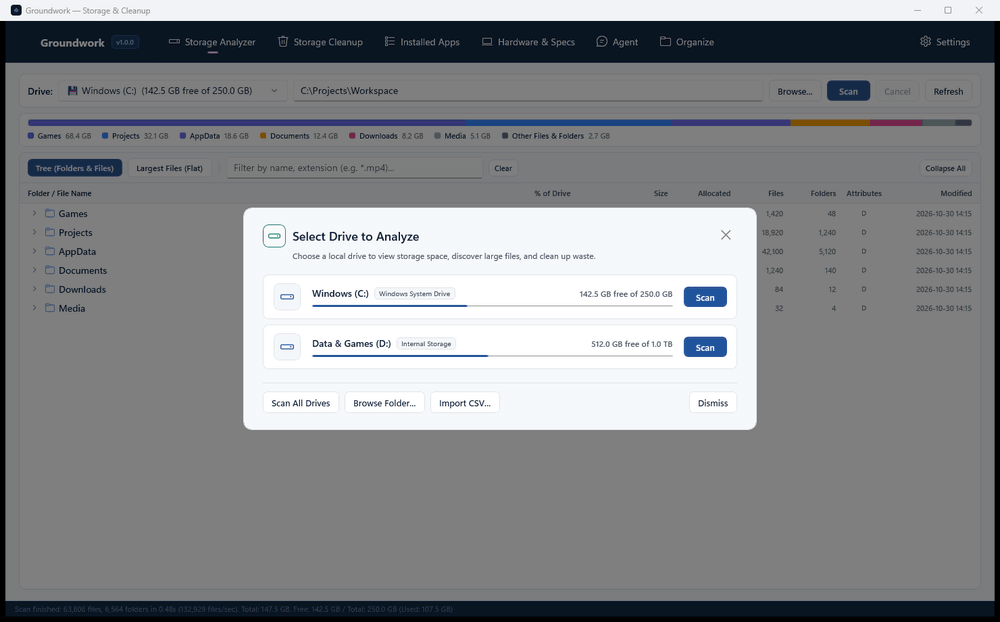

# Groundwork

<p align="center">
  
</p>

<p align="center">
  <strong>AI-Assisted Windows System Management, Diagnostics, Optimization, Troubleshooting &amp; Maintenance Toolkit</strong>
</p>

<p align="center">
  <a href="https://github.com/ttnhan227/Groundwork/actions/workflows/release.yml"></a>
  
  
  
</p>

<p align="center">
  
</p>

---

## 📌 Overview & Core Promise

**Understand your PC. Investigate problems. Optimize with confidence. Maintain control.**

**Groundwork** is a native Windows system companion built with **C#, .NET 10, and WinUI 3** that helps users understand their computers, investigate problems, optimize Windows, and perform safe maintenance through a unified desktop application:

1. **Overview & Guided Investigations**: Live hardware, OS, storage, network, startup, and servicing snapshot with one-click **Groundwork Investigations** (*Performance*, *Storage*, *Network*, *Windows Health*, *Startup*, *Hardware*, and *Custom Symptoms*) that strictly separate **Confirmed Observations** from **Potential Contributing Factors** and **Unverified Hypotheses**.
2. **Analyze (Storage & Hardware/Process Diagnostics)**: Multi-worker Win32 `FindFirstFileExW` directory walker, bottom-up $O(N)$ folder size rollups, WMI/SMBIOS hardware & driver topology, and live CPU/RAM process inspection.
3. **Optimize (Power, Startup & Transparent Configuration)**: Inspect and switch Windows power plans (`powercfg`), manage `HKCU`/`HKLM` `Run` keys and Startup folders with publisher verification and reversible toggles, and configure Windows Game Mode, Game DVR, Visual Transparency, and privacy settings with full recovery state.
4. **Troubleshoot (Network, Event Log & Windows Repair)**: Active network adapter IP/Gateway/DNS inspection, ICMP Ping, DNS lookup, well-known DNS provider guidance, Windows `System` and `Application` Event Log error explanations, and core Windows Services / `SFC` / `DISM` health checks.
5. **Maintenance (Safe Cleanup, Duplicates, File Organizer & Rollback Ledger)**: Token-gated Recycle Bin cleanup (`SHFileOperationW`), 3-stage SHA-256 duplicate finder, reversible Smart File Organizer, and a persistent **Safe Operation History & Rollback Ledger**.
6. **Applications**: Fast Win32 Registry enumeration of installed applications, monitored uninstaller execution, and bounded leftover file/registry cleanup.
7. **System-Aware AI Assistant**: Backed by `ToolRegistryService` and `AgentPlannerService` — works deterministically offline using local diagnostic tools, or connects to local `Ollama` / `LM Studio` and cloud providers (`Gemini`, `OpenAI`, `Anthropic Claude`, `Mistral`, `Custom`) with DPAPI-encrypted API keys.

---

## 🛡️ Safe Operation Framework (10-Step Lifecycle)

Every modifying action in Groundwork passes through `SafeOperationEngine` and `PolicyEngine`:
1. **Inspect** current system state
2. **Validate** prerequisites and elevation boundaries
3. **Capture** original state (`PreChangeStateJson`)
4. **Explain** the proposed change in plain language
5. **Display** potential risks, affected targets, and reversibility (`ReadOnly`, `Reversible`, `PartiallyReversible`, `Irreversible`)
6. **Request Approval** via a single-use, time-bounded confirmation token
7. **Execute** the operation using explicit Win32/Registry/process APIs (never arbitrary shell strings)
8. **Verify** the actual resulting system state
9. **Record** the execution and verification outcome in `OperationHistoryService`
10. **Provide Recovery / Rollback** with one click

---

## 🛠️ Building & Testing from Source

### Prerequisites
- Windows 10 (Build 19041+) or Windows 11 (x64)
- [.NET 10.0 SDK](https://dotnet.microsoft.com/download)

### Run Automated Unit Tests
```powershell
dotnet test desktop-winui/Groundwork.slnx -c Release
```

### Build & Run the WinUI 3 Desktop Application
```powershell
dotnet build desktop-winui/Groundwork.slnx -c Release
dotnet run --project desktop-winui/src/Groundwork.Desktop/Groundwork.Desktop.csproj -c Release
```

---

## 📚 Documentation

- [AGENTS.md](AGENTS.md) — Engineering principles, agent architecture, and module overview
- [docs/PRODUCT_SPECIFICATION.md](docs/PRODUCT_SPECIFICATION.md) — Product specification and interaction model
- [docs/ARCHITECTURE.md](docs/ARCHITECTURE.md) — Engine, Safe Operation Framework, Tool Registry, and UI architecture
- [docs/PRIVACY_MODEL.md](docs/PRIVACY_MODEL.md) — Local-first data boundaries, DPAPI credential encryption, and execution safety
- [docs/SEARCH_AND_RANKING.md](docs/SEARCH_AND_RANKING.md) — Storage scanning, 3-stage duplicate hashing, and investigation ranking

---

## 📄 License

Distributed under the **MIT License**. See `LICENSE` for full details.
