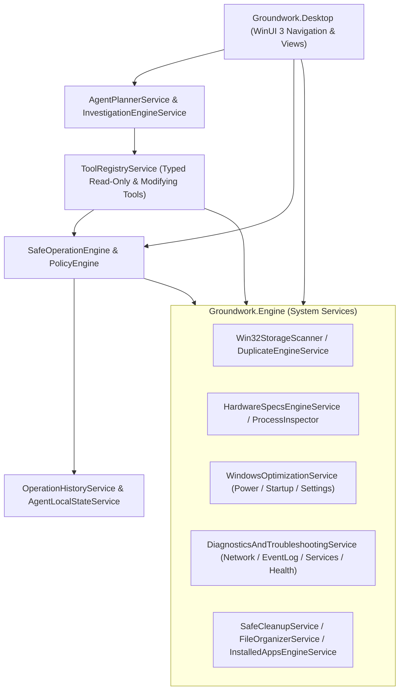

# Groundwork — System Architecture

## 1. Architectural Overview

Groundwork is built on **.NET 10** and **Windows App SDK (WinUI 3)** with a strict separation between the system engine (`Groundwork.Engine`) and the presentation layer (`Groundwork.Desktop`).

---

## 2. Core Subsystems in `Groundwork.Engine`

### 2.1 System Context & Hardware/Storage Inspection
- **`Win32StorageScanner`**: Parallel directory walker using `FindFirstFileExW` with `FindExInfoBasic` and `FIND_FIRST_EX_LARGE_FETCH`. Skips reparse points (`FILE_ATTRIBUTE_REPARSE_POINT`) to prevent symlink loops, detects cloud placeholders (`FILE_ATTRIBUTE_RECALL_ON_DATA_ACCESS` / `FILE_ATTRIBUTE_OFFLINE`), and computes bottom-up $O(N)$ directory size rollups.
- **`DuplicateEngineService`**: Three-stage pipeline (file size grouping → 4 KB head + 4 KB tail SHA-256 pre-hash → full SHA-256 hash) with NTFS hard-link exclusion via `GetFileInformationByHandle` (`VolumeSerialNumber` + `FileIndex`).
- **`HardwareSpecsEngineService`**: Queries WMI (`System.Management`), SMBIOS memory tables, Win32 Registry, and Performance Counters for CPU, Motherboard/BIOS/SecureBoot, GPUs, RAM modules, Physical Disks & partition maps, Network Adapters, Signed Drivers, and live CPU/GPU/Disk telemetry.

### 2.2 Safe Operation Engine & Policy Engine
Every modifying operation in Groundwork is classified by:
- **`OperationReversibility`**: `ReadOnly`, `Reversible`, `PartiallyReversible`, or `Irreversible`.
- **`OperationRiskLevel`**: `None`, `Low`, `Medium`, `High`, or `Critical`.
- **`OperationElevationRequirement`**: `StandardUser` or `AdministratorRequired`.

All system modifications follow the **10-Step Safe Operation Lifecycle**:
1. **Inspect** current system state.
2. **Validate** prerequisites and elevation requirements via `PolicyEngine`.
3. **Capture** original state (`PreChangeStateJson`) for rollback.
4. **Explain** the proposed change in plain language.
5. **Display** potential risks, affected targets, and reversibility.
6. **Request Approval** via a single-use, time-bounded token (`OperationProposal`).
7. **Execute** the operation using explicit Win32/Registry/process APIs (never arbitrary shell interpolation).
8. **Verify** the actual resulting system state (`OperationVerificationResult`).
9. **Record** the execution and verification outcome in `OperationHistoryService`.
10. **Provide Recovery / Rollback** (`RollbackOperationAsync`) using the captured pre-change state.

### 2.3 Tool Registry & Agent Architecture
- **`ToolRegistryService`**: Registers strongly typed system tools (`AgentToolDefinition`), each declaring its name, category, description, parameters schema, required permissions, read-only vs. modifying classification, preconditions, expected output, and risk level.
- **`InvestigationEngineService`**: Executes multi-tool diagnostic workflows (*Performance*, *Storage*, *Network*, *Windows Health*, *Startup*, *Hardware*, and *Custom*). Produces structured `InvestigationReport` objects containing:
  - `ConfirmedObservations`: Facts verified directly from live system telemetry.
  - `PotentialCauses`: Evidence-backed contributing factors.
  - `UnverifiedHypotheses`: Possibilities that require additional hardware sensors or external checks.
  - `RecommendedActions`: Actionable proposals linked to the Safe Operation Engine.
- **`AgentPlannerService`**: Maps natural-language user requests to registered tools and investigations, executes read-only tools automatically, gates any modifying tool behind user approval, and enriches LLM prompts with structured tool evidence.

### 2.4 Optimization, Troubleshooting & Maintenance Services
- **`WindowsOptimizationService`**: Power plan inspection and switching (`powercfg`), Startup entry discovery and reversible toggling (`HKCU\...\Run`, `HKLM\...\Run`, Startup folders, and backup ledger), and Windows performance/privacy configuration (Game Mode, Visual Transparency, HAGS status).
- **`DiagnosticsAndTroubleshootingService`**: Active process resource inspection, network interface/IP/Gateway/DNS inspection, ICMP Ping, DNS lookup, TCP connectivity checks, Windows Event Log (`System` & `Application`) error analysis, Windows Services health inspection, and Windows Repair/Update status checks.
- **`FileOrganizerService`**: Categorizes cluttered folders into structured subfolders and executes reversible moves with full undo support via `OperationHistoryService`.
