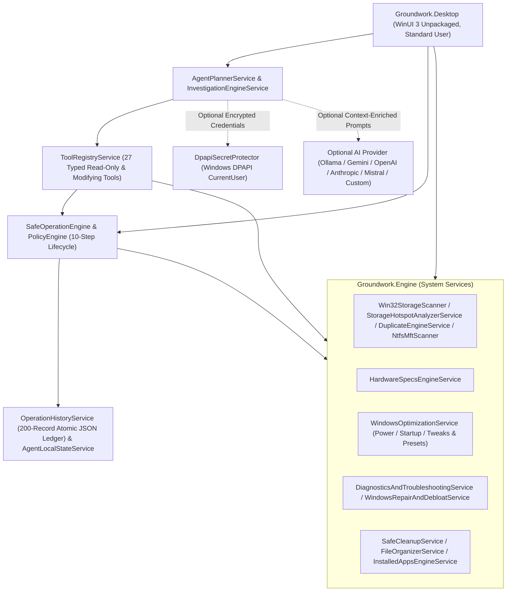
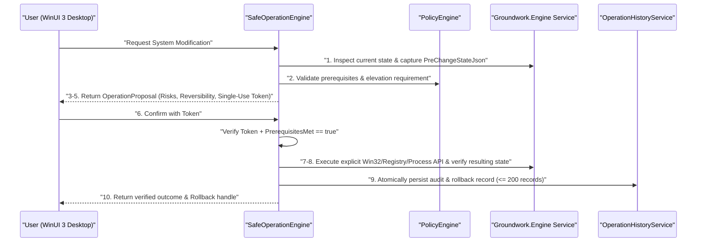

# Groundwork — System Architecture

This document describes the system design, architectural decisions, safety and concurrency boundaries, local-first observability, failure recovery behavior, and verified test evidence for **Groundwork**.

---

## 1. System Context & Component Architecture

Groundwork is built on **.NET 10** and **Windows App SDK (WinUI 3)** as an unpackaged, self-contained Windows desktop application running under **standard-user least privilege**, with a strict separation between the system engine (`Groundwork.Engine`), the elevated NTFS helper (`Groundwork.MftHelper`), and the presentation layer (`Groundwork.Desktop`).

### Safe Operation Lifecycle Sequence

---

## 2. Core Subsystems in `Groundwork.Engine`

### 2.1 System Context & Hardware/Storage Inspection
- **`Win32StorageScanner`**: Parallel directory walker using `FindFirstFileExW` with `FindExInfoBasic` and `FIND_FIRST_EX_LARGE_FETCH`, coordinated by an atomic `pendingWorkCount` termination counter. Skips reparse points (`FILE_ATTRIBUTE_REPARSE_POINT`) to prevent symlink loops, detects cloud placeholders (`FILE_ATTRIBUTE_RECALL_ON_DATA_ACCESS` / `FILE_ATTRIBUTE_OFFLINE`), and computes bottom-up $O(N)$ directory size rollups.
- **`NtfsMftScanner` & `Groundwork.MftHelper`**: Experimental NTFS volume/MFT scanning path kept separate from the default `Win32StorageScanner` so standard-user scans remain reliable without requiring elevation.
- **`DuplicateEngineService`**: Three-stage pipeline (file size grouping -> 4 KB head + 4 KB tail SHA-256 pre-hash -> full SHA-256 hash) with NTFS hard-link exclusion via `GetFileInformationByHandle` (`VolumeSerialNumber` + `FileIndex`) and cloud placeholder protection so OneDrive/iCloud stubs are never hydrated during hashing.
- **`HardwareSpecsEngineService`**: Queries WMI (`System.Management`), SMBIOS memory tables, Win32 Registry, and Performance Counters for CPU, Motherboard/BIOS/SecureBoot, GPUs, RAM modules, Physical Disks & partition maps, Network Adapters, Signed Drivers, and live CPU/GPU/Disk telemetry.

### 2.2 Safe Operation Engine & Policy Engine
Every modifying operation in Groundwork is classified by:
- **`OperationReversibility`**: `ReadOnly`, `Reversible`, `PartiallyReversible`, or `Irreversible`.
- **`OperationRiskLevel`**: `None`, `Low`, `Medium`, `High`, or `Critical`.
- **`OperationElevationRequirement`**: `StandardUser` or `AdministratorRequired`.

All system modifications follow the **10-Step Safe Operation Lifecycle**:
1. **Inspect** current system state.
2. **Validate** prerequisites and elevation requirements via `PolicyEngine`.
3. **Capture** original state (`PreChangeStateJson`) for rollback.
4. **Explain** the proposed change in plain language.
5. **Display** potential risks, affected targets, and reversibility.
6. **Request Approval** via a single-use, time-bounded token (`OperationProposal`).
7. **Execute** the operation using explicit Win32/Registry/process APIs (never arbitrary shell interpolation).
8. **Verify** the actual resulting system state (`OperationVerificationResult`).
9. **Record** the execution and verification outcome in `OperationHistoryService`.
10. **Provide Recovery / Rollback** (`RollbackOperationAsync`) using the captured pre-change state.

### 2.3 Tool Registry & Agent Architecture
- **`ToolRegistryService`**: Registers `27` strongly typed system tools (`AgentToolDefinition`), each declaring its name, category, description, parameters schema, required permissions, read-only vs. modifying classification, preconditions, expected output, and risk level.
- **`InvestigationEngineService`**: Executes deduplicated multi-tool diagnostic workflows (*Performance*, *Storage*, *Network*, *Windows Health*, *Startup*, *Hardware*, and *Custom*) so overlapping tool calls within a single investigation are not run redundantly. Produces structured `InvestigationReport` objects containing `ConfirmedObservations`, `PotentialCauses`, `UnverifiedHypotheses`, and `RecommendedActions`.
- **`AgentPlannerService`**: Maps natural-language user requests to registered tools and investigations, executes read-only tools automatically, gates any modifying tool behind user approval, and enriches optional LLM prompts with structured tool evidence.

### 2.4 Optimization, Troubleshooting, Repair & Debloat Services
- **`WindowsOptimizationService`**: Power plan inspection, switching, Ultimate Performance unlock (`powercfg`), and `hiberfil.sys` Hibernation toggle; Startup entry discovery across `HKCU`/`HKLM`/Startup folders/Tasks with reversible toggling; and hidden Windows 11/privacy/gaming registry tweaks + atomic batch presets.
- **`DiagnosticsAndTroubleshootingService`**: Active process resource inspection, network interface/IP/Gateway/DNS inspection, ICMP Ping, DNS lookup, TCP connectivity checks, reversible DNS provider switching, Windows Event Log (`System` & `Application`) error analysis, Windows Services health inspection, and `DISM` health checks using concurrent stdout/stderr reads (`RunProcessAsync`) to prevent OS pipe deadlocks.
- **`WindowsRepairAndDebloatService`**: 1-click gated repair workflows (Explorer icon cache, Winsock/IP reset, Print Spooler queue, Windows Update cache, `WinSxS` cleanup, `sfc /scannow`) using concurrent stdout/stderr process execution (`DefaultRunProcess`), runtime health checks (`VC++`, `.NET Desktop`, `WebView2`), protected Microsoft Store (`Appx`) bloatware removal, and curated `winget` package setup.
- **`StorageHotspotAnalyzerService` & `FileOrganizerService`**: Deep GPU/OTA/browser/dev cache & `.vhdx` space-hog analysis, Recycle-Bin-only deletion (`SHFileOperationW` in `SafeCleanupService`), and reversible file organization via `OperationHistoryService`.

---

## 3. Key Architectural Decision Records (ADRs)

### ADR-01: Strict `Groundwork.Engine` vs. `Groundwork.Desktop` Separation
- **Context:** WinUI 3 views require Windows UI thread dispatchers and XAML packages that are difficult to exercise in headless automated unit tests.
- **Decision:** Keep all storage scanning, diagnostics, optimization, policy checks, and rollback logic inside `Groundwork.Engine` (pure .NET 10 class library), leaving `Groundwork.Desktop` as a thin WinUI 3 presentation layer.
- **Trade-offs & Known Limitations:** Enables fast, deterministic `dotnet test` execution of `77` engine tests without launching a desktop window, while leaving WinUI XAML layout and interactive desktop rendering outside automated unit test coverage.

### ADR-02: Standard-User Least Privilege & Token-Gated `SafeOperationEngine`
- **Context:** Running a full desktop utility permanently as Administrator expands the blast radius of any bug or unintended user click, especially when an optional AI assistant is present.
- **Decision:** Launch `Groundwork.Desktop` as a standard user (`Unpackaged`, self-contained). `SafeOperationEngine` enforces `PrerequisitesMet` (including elevation checks) and single-use, time-bounded confirmation tokens before executing any mutating operation, and restricts file deletion to the Windows Recycle Bin (`SHFileOperationW`).
- **Trade-offs & Known Limitations:** Administrator-required repairs (`sfc /scannow`, `hiberfil.sys`, `DISM`, Winsock reset) require explicit elevation rather than silently succeeding in a standard-user session.

### ADR-03: Parallel Win32 `FindFirstFileExW` Over Experimental NTFS MFT Default
- **Context:** Direct NTFS Master File Table (MFT) parsing requires Administrator privileges (`\\.\C:` volume handle) and NTFS-specific structures, failing on non-NTFS volumes or standard-user sessions.
- **Decision:** Use parallel Win32 `FindFirstFileExW` (`Win32StorageScanner`) with atomic `pendingWorkCount` termination as the default scanner across all filesystems and privilege levels, keeping `NtfsMftScanner` / `Groundwork.MftHelper` strictly experimental and opt-in.
- **Trade-offs & Known Limitations:** `FindFirstFileExW` is slightly slower than raw MFT reads on multi-million-file NTFS volumes, but works safely under standard-user privileges, respects NTFS ACLs, and handles FAT32/exFAT/network drives cleanly.

### ADR-04: Local-First DPAPI Secret Storage & Atomic 200-Record Rollback Ledger
- **Context:** Users who opt into cloud AI providers need encrypted local API key storage without introducing external key vaults or database servers.
- **Decision:** `DpapiSecretProtector` encrypts provider API keys at rest with Windows DPAPI (`ProtectedData` / `CryptProtectData`, `DataProtectionScope.CurrentUser`). `OperationHistoryService` persists up to `200` audit/rollback records using atomic JSON file writes under `%LocalAppData%\Groundwork`.
- **Trade-offs & Known Limitations:** DPAPI keys are bound to the current Windows user profile (non-portable across machines), and the 200-record rolling window trims older history entries after 200 executed operations.

---

## 4. Data Integrity, Concurrency & Security Boundaries

| Boundary | Mechanism & Implementation |
| :--- | :--- |
| **Execution Safety** | `SafeOperationEngine` + `PolicyEngine` enforce `PrerequisitesMet`, single-use expiring tokens, and explicit Win32/Registry/process APIs; AI agents cannot execute arbitrary shell or PowerShell strings. |
| **Uninstaller & Registry Guards** | `InstalledAppsEngineService` parses `UninstallString` directly without `cmd.exe /c`, rejects unsafe shell metacharacters, and enforces registry allowlist depth guards before leftover cleanup. |
| **Recycle-Bin-Only Deletion** | `SafeCleanupService` deletes files through Win32 `SHFileOperationW` (`FO_DELETE` + `FOF_ALLOWUNDO`), never permanent raw `File.Delete` for user-facing cleanup. |
| **Process Pipe Deadlock Prevention** | `DiagnosticsAndTroubleshootingService.RunProcessAsync` and `WindowsRepairAndDebloatService.DefaultRunProcess` read stdout and stderr concurrently with bounded timeouts so child processes (`DISM`, `sfc`, `powercfg`, `winget`) cannot deadlock on full pipe buffers. |
| **Local-First Privacy** | All scanning, duplicate hashing, diagnostics, and rollback ledgers remain 100% local; API keys are encrypted via `DpapiSecretProtector`. See [docs/PRIVACY_MODEL.md](./PRIVACY_MODEL.md). |

---

## 5. Observability & Local-First Diagnostics

Because Groundwork is a local-first desktop toolkit with zero telemetry phone-home, observability is structured for the local user and support exports:

- **Audit & Rollback Ledger (`OperationHistoryService`):** Records every proposed, executed, verified, and rolled-back operation with pre-change snapshots, verification status, and timestamps.
- **Structured Investigation Reports (`InvestigationEngineService`):** Separates `ConfirmedObservations`, `PotentialCauses`, and `UnverifiedHypotheses` and exports to `.md`, `.json`, and `.txt` for transparent troubleshooting.
- **Honest Sensor Reporting (`HardwareSpecsEngineService`):** When hardware sensors (such as CPU package temperature) are not exposed without a signed kernel driver, Groundwork explicitly reports `N/A` with an explanation instead of fabricating values.

---

## 6. Failure Scenarios & Recovery Matrix

| Failure Mode | System Behavior | Safeguard / Recovery | Known Limit |
| :--- | :--- | :--- | :--- |
| **Standard user triggers Administrator-only repair** | `PolicyEngine` marks `PrerequisitesMet = false` (`AdministratorRequired`). | `SafeOperationEngine` blocks execution even if a token is presented and explains that elevation is required. | In-process UAC auto-elevation is not performed automatically. |
| **Malicious or malformed `UninstallString` in Registry** | `InstalledAppsEngineService` inspects executable path and arguments without invoking `cmd.exe /c`. | Rejects strings containing unsafe shell metacharacters; enforces registry allowlist depth limits on leftover cleanup. | Non-standard legacy installers relying on shell scripting syntax must be uninstalled through Windows Settings. |
| **Child process (`DISM`/`sfc`/`winget`) stalls or floods output** | Concurrent stdout/stderr readers drain both pipes under a bounded timeout. | Prevents OS pipe-buffer deadlock; cancels and reports structured timeout error. | Partial OS component repairs interrupted by timeout require re-running once locks clear. |
| **Symlink loop or OneDrive cloud placeholder during scan/dedupe** | `Win32StorageScanner` skips `FILE_ATTRIBUTE_REPARSE_POINT`; `DuplicateEngineService` skips cloud placeholders and deduplicates NTFS hard links via `FileIndex`. | Prevents infinite recursion, accidental cloud downloads, and false-positive duplicate deletion of hard-linked files. | Hard-linked files across separate volumes are compared normally by content hash. |
| **Hardware thermal sensor unavailable without kernel driver** | WMI/ACPI thermal queries return empty or unsupported. | `HardwareSpecsEngineService` reports `N/A` and explains the Windows driver boundary. | Groundwork intentionally ships no kernel-mode driver (`WinRing0`/etc.) to avoid kernel attack surface. |
| **Cleanup or file organization mistake** | User wants to undo a cleanup or Tidy Folder move. | `SafeCleanupService` sends files to the Windows Recycle Bin; `FileOrganizerService` + `OperationHistoryService` provide 1-click rollback from captured `PreChangeStateJson`. | Rollback ledger retains the most recent `200` operations; emptied Recycle Bin items cannot be restored by Groundwork. |

---

## 7. Verified Engineering & Testing Evidence

### Automated Test Suites (Verified in Repository)

| Suite | Command | Verified Coverage & Scope |
| :--- | :--- | :--- |
| **Engine Unit & Safety Suite (.NET 10 xUnit)** | `dotnet test desktop-winui/Groundwork.slnx -c Release` | **77 xUnit tests** in `Groundwork.Engine.Tests` covering `SafeOperationEngine` token/prerequisite gates, `PolicyEngine`, `OperationHistoryService` atomic persistence & rollback, `Win32StorageScanner`, `DuplicateEngineService` 3-stage pipeline & hard-link/placeholder guards, `InstalledAppsEngineService` metacharacter/allowlist guards, `InvestigationEngineService`, `WindowsOptimizationService`, and `WindowsRepairAndDebloatService`. |
| **Marketing / Release Site Suite (Web/Playwright)** | `npm --prefix client test` | **23 tests across 7 test files** in `client/tests/` covering accessibility contrast scaling, CSP security headers, SPA navigation, release download UI, and rendered HTML. |
| **Desktop Build Verification** | `dotnet build desktop-winui/Groundwork.slnx -c Release` | Compiles `Groundwork.Engine`, `Groundwork.MftHelper`, `Groundwork.Desktop` (WinUI 3), and `Groundwork.Engine.Tests` with 0 errors. |

### Known Verification Gaps & Unmeasured Benchmarks
- **WinUI 3 Desktop UI Runtime Coverage:** Interactive XAML views, window chrome, and live WinUI visual interactions are verified manually on Windows 10/11 rather than through automated UI-driver tests.
- **Large-Volume Scan Throughput (1M+ Files):** **Not measured under standardized benchmark conditions.**
- **Recommended Benchmark Method:** Run `Win32StorageScanner` and `DuplicateEngineService` against a controlled NTFS test directory tree (e.g., 100k and 1M files with known hard-link and duplicate ratios) on a local NVMe drive, recording wall-clock duration, peak working set, and worker count scaling.
