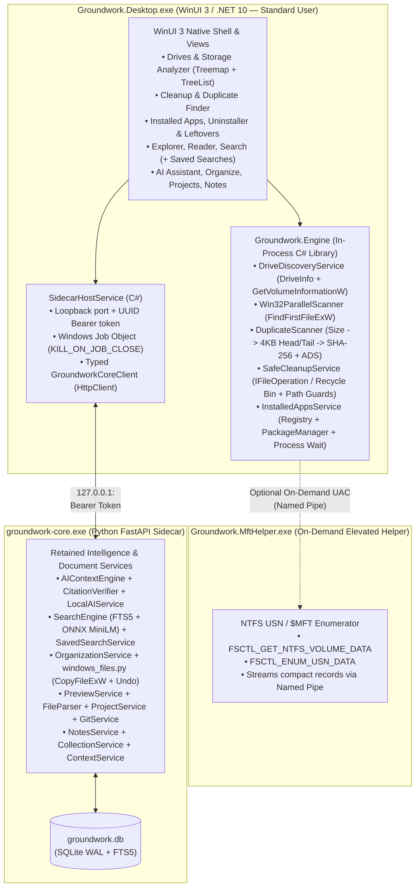

# Groundwork 1.0 — Ordered Migration & Implementation Plan

## 1. Locked Architectural Decisions & Verified Environment

| Decision Area | Locked Choice for Groundwork 1.0 |
| :--- | :--- |
| **Target UI & Desktop Host** | **Native C# + WinUI 3 (`Microsoft.WindowsAppSDK`)** targeting **`net10.0-windows10.0.19041.0`** (verified installed SDK on machine: `.NET SDK 10.0.301`, `Microsoft.WindowsDesktop.App 10.0.9`). Replaces Tauri/Rust and React/WebView2. |
| **Backend Boundary (Hybrid)** | **1. Native C# Engine (`Groundwork.Engine`):** Owns automatic whole-drive discovery, parallel Win32 directory scanning, on-demand elevated NTFS USN/MFT scanning, 3-stage duplicate detection, rule-based system/drive cleanup, safe Recycle Bin / permanent deletion, installed-app enumeration, monitored uninstaller execution, and leftover scanning. **2. Python Sidecar (`groundwork-core`):** Retained for AI Operator (`AIContextEngine`, `CitationVerifier`), local GGUF LLM runtime (`LocalAIService`), document parsing/preview (`FileParser`, `PreviewService`), hybrid FTS5 + ONNX search (`SearchEngine`), Saved Searches (`SavedSearchService`), safe file organization & undo journals (`OrganizationService`), Projects/Git (`ProjectService`, `GitService`), Notes, Collections, Activity, and Context Sessions. |
| **Database Ownership Boundary** | **Zero Cross-Process SQLite Write Contention:** • `Groundwork.Engine` (C#) holds whole-drive scan trees in a compact in-memory arena (for instant treemap/folder sorting) with optional snapshots in `groundwork_storage.db`. • `groundwork-core` (Python) exclusively owns `groundwork.db` for scoped document workspaces, FTS5 chunks, embeddings, notes, saved searches, sessions, and organization plans. |
| **Elevation Model** | **Standard User by Default (`asInvoker`):** Uses multi-threaded Win32 `FindFirstFileExW` (`FindExInfoBasic` + `FIND_FIRST_EX_LARGE_FETCH`) by default. Provides an explicit, user-triggered **"Accelerate with Admin (NTFS MFT)"** button on local NTFS drives that launches a short-lived elevated scanner helper (`runas`) over a local named pipe, with automatic fallback if UAC is declined. |
| **Cloud Sync** | **Retire from 1.0 Product:** Remove first-launch sign-in prompt and cloud account UI; retire `server/app/hosted/`, `sync_service.py`, `google_signin_service.py`, and cloud-only dependencies while **preserving all local `notes` and `saved_searches` data** in `groundwork.db`. |
| **Saved Searches** | **Preserve & Expose:** Keep `SavedSearchService` (`/api/saved-searches` and `saved_searches` table) and wire it into the native WinUI 3 Search experience (save search + filters, list, one-click run, delete). |
| **Registry Leftovers** | **Read-Only for 1.0:** Inspect `HKCU\Software` and `HKLM\Software` (`WOW6432Node`) in read-only mode, displaying confidence levels (`high` vs. `review_required`) and evidence explanations without registry key deletion. |

---

## 2. Interface & Responsibility Boundary

---

## 3. Phased Implementation Sequence & Acceptance Criteria

### Phase 1: Safety Critical Fixes, Backend Hardening & Dead-Code Cleanup (Batch 1)
**Goal:** Eliminate all P0/P1 safety hazards and bugs in the Python backend and remove confirmed dead backend code while preserving uncommitted work and passing all retained tests.

1. **Fix Deletion Safety Hazards ([`cleanup_service.py`](file:///c:/Users/ttnha/Documents/projects/Groundwork/server/app/services/cleanup_service.py)):**
   - Remove the silent permanent deletion fallback (`shutil.rmtree` / `unlink()`) when `mode == "recycle"` fails (`L689-695`). Record any Recycle Bin failure in `failed` with a clear message requiring explicit permanent mode confirmation.
   - Fix `_is_protected_system_path` (`L84-100`) so `C:\Windows\System32`, `C:\Windows\SysWOW64`, `C:\Windows\WinSxS`, and all descendants of `C:\Windows`, `C:\Program Files`, `C:\Program Files (x86)` (outside verified leftover directories), `$Recycle.Bin`, `System Volume Information`, `Recovery`, and user profile root shell folders (`Desktop`, `Documents`, `Pictures`, `AppData` root) are strictly blocked regardless of path depth (`len(parts)`).
   - Add raw-path reparse-point (`is_symlink()` / `is_junction()`) checks before `Path.resolve()` so cleanup never follows a junction/symlink into its target directory.
2. **Fix Installed-App Leftover & Uninstaller Bugs ([`installed_apps.py`](file:///c:/Users/ttnha/Documents/projects/Groundwork/server/app/services/installed_apps.py)):**
   - Allow verified custom `install_location` paths in `propose_leftover_cleanup` / `execute_leftover_cleanup` when they match the app's discovered leftover set, while restricting arbitrary non-candidate paths under `Program Files` / `AppData`.
   - Expand read-only registry leftover checks to include `HKLM\Software` and `HKLM\Software\WOW6432Node` alongside `HKCU\Software`.
3. **Fix Duplicate Detection Scaling & Cloud-Placeholder Safety ([`duplicate_service.py`](file:///c:/Users/ttnha/Documents/projects/Groundwork/server/app/services/duplicate_service.py)):**
   - Replace `WHERE size_bytes IN (?, ?, ...)` with a SQLite subquery/join so >32,766 colliding file sizes never trigger `sqlite3.OperationalError: too many SQL variables`.
   - Skip files with `CLOUD_PLACEHOLDER_MASK` (`FILE_ATTRIBUTE_OFFLINE | FILE_ATTRIBUTE_RECALL_ON_OPEN | FILE_ATTRIBUTE_RECALL_ON_DATA_ACCESS`) so duplicate scanning never hydrates OneDrive/iCloud files.
   - Add a 4 KB head + 4 KB tail pre-hash stage before full-file SHA-256 hashing.
   - Exclude hard-link aliases (`(st_dev, st_ino)`) from `CleanupService` `exact_duplicates` candidates so hard links are not falsely reported as reclaimable space.
4. **Fix Built-in AI Preference Bug & Indexer Entanglement ([`api.py`](file:///c:/Users/ttnha/Documents/projects/Groundwork/server/app/routers/api.py), [`indexer_service.py`](file:///c:/Users/ttnha/Documents/projects/Groundwork/server/app/services/indexer_service.py)):**
   - Add `"builtin"` to the allowed `ai_provider` set in `PUT /api/system/preferences` (`api.py:918`).
   - Prevent drive roots (`C:\`) from automatically starting full-drive `watchfiles` or full-drive content embedding indexing unless scoped folders are selected.
   - Consolidate duplicate `.gitignore` / exclusion logic between `IndexerService._is_ignored` and `ExclusionRuleCache`.
5. **Remove Confirmed Dead Backend Code & Write-Only Tables:**
   - Remove `server/app/services/ai/investigation.py` and `/api/ai/investigate`.
   - Remove `server/app/services/assistant_actions.py`, `/api/ai/actions/propose`, `/api/ai/actions/execute`, and `server/tests/test_assistant_actions.py`.
   - Remove write-only operations to `fts_files` and `indexing_runs` in `indexer_service.py` and `workspace_service.py` (keeping schema definitions harmlessly in `local_db.py` so existing databases need no destructive migration).
   - Delete `server/requirements-local-embeddings.txt`.

**Phase 1 Acceptance Criteria:**
- All retained `pytest` tests in `server/tests/` pass, plus new regression tests verifying:
  - `mode="recycle"` never permanently deletes a file when Recycle Bin fails.
  - `C:\Windows\System32` and NTFS junctions/symlinks are blocked from recursive deletion.
  - `DuplicateService` handles >40,000 size groups without SQLite variable errors, skips cloud placeholders, and uses 4 KB head/tail pre-hashing.
  - `PUT /api/system/preferences` accepts `{"ai_provider": "builtin"}`.

---

### Phase 2: Native C#/.NET 10 Windows Storage & Maintenance Engine (`Groundwork.Engine`)
**Goal:** Build and benchmark the native C# Windows engine for whole-drive discovery, fast Win32 + on-demand elevated MFT scanning, 3-stage duplicate detection, safe cleanup, and native installed-app management.

1. **Create Solution & Projects (`desktop-winui/Groundwork.sln`):**
   - `Groundwork.Engine` (`net10.0-windows10.0.19041.0` class library)
   - `Groundwork.MftHelper` (`net10.0-windows10.0.19041.0` console helper for on-demand elevated NTFS USN/MFT enumeration)
   - `Groundwork.Engine.Tests` (`net10.0-windows10.0.19041.0` xUnit test suite + benchmark runner)
2. **Implement Automatic Drive Discovery (`DriveDiscoveryService`):**
   - Enumerate all volumes via `DriveInfo.GetDrives()` + Win32 `GetVolumeInformationW`, returning volume label, mount path (`C:\`), filesystem (`NTFS`, `ReFS`, `exFAT`, `FAT32`), drive type (`Fixed`, `Removable`, `Network`), total/used/free bytes, and whether MFT acceleration is supported.
3. **Implement Dual-Mode Whole-Drive Scanner (`StorageScannerService`):**
   - **Standard-User Mode (Default):** Multi-threaded work-stealing Win32 `FindFirstFileExW` (`FindExInfoBasic`, `FIND_FIRST_EX_LARGE_FETCH`) scanner that skips reparse points (`FILE_ATTRIBUTE_REPARSE_POINT`), reads logical size + physical allocated size (`GetCompressedFileSizeW` on sparse/compressed files), rolls up folder sizes bottom-up in a compact contiguous struct array, supports instant `CancellationToken`, and streams live progress (`filesScanned`, `bytesScanned`, `currentPath`, `errors`) every 100ms.
   - **On-Demand Elevated NTFS MFT Mode:** `Groundwork.MftHelper` opens `\\.\<Drive>:` with `GENERIC_READ`, queries `FSCTL_GET_NTFS_VOLUME_DATA` and `FSCTL_ENUM_USN_DATA` (`MFT_ENUM_DATA_V0`), resolves file sizes and parent File Reference Numbers (`FRN`), and streams the tree over a named pipe to `Groundwork.Engine` with automatic fallback to `Win32ParallelScanner` if UAC is cancelled or unsupported.
4. **Implement Native Duplicate, Cleanup & Installed Apps Services in `Groundwork.Engine`:**
   - `NativeDuplicateService`: 3-stage pipeline (Size grouping -> 4 KB head/tail `SHA256` / `XxHash64` -> Full `SHA256` + NTFS ADS check), skipping cloud placeholders and hard-link aliases (`GetFileInformationByHandle`).
   - `NativeCleanupService`: Scans system & drive cleanup rules (Temp/Logs, Build/Runtime Caches, Windows/User Temp, Installers/Archives, Large Stale Files, Exact Duplicates) and executes token-confirmed removal via Win32 `SHFileOperationW` / COM `IFileOperation` (Recycle Bin without silent permanent fallback) and strict protected-path + reparse-point guards.
   - `NativeInstalledAppsService`: Direct Win32 Registry (`HKLM`/`HKCU` Uninstall + `WOW6432Node`) + `PackageManager` enumeration (no slow PowerShell subprocess!), native icon extraction, safe uninstaller launcher with `Process.WaitForExitAsync()` monitoring, and filesystem + read-only registry leftover scanner.

**Phase 2 Acceptance Criteria:**
- `dotnet test desktop-winui/Groundwork.sln` passes 100% of unit and integration tests (drive discovery, Win32 scan, MFT record parsing, ACL denial resilience, cancellation, duplicate 3-stage hashing, protected path rejection, Recycle Bin safety, app enumeration, and leftover detection).
- **Measured Real-Drive Benchmark Report:** Run the benchmark runner against the actual local `C:\` drive (or a large realistic NTFS volume on this machine) and record verified file count, directory count, scan duration, throughput (`files/sec`), peak working set (MB), and cancellation latency.

---

### Phase 3: Native WinUI 3 Desktop Shell & Primary Storage/Maintenance Views
**Goal:** Build the native Windows 11 WinUI 3 application (`Groundwork.Desktop`) delivering the primary storage, cleanup, duplicate, and installed-app workflows without any WebView.

1. **WinUI 3 Application Shell (`Groundwork.Desktop`):**
   - Unpackaged WinUI 3 desktop app (`WindowsPackageType=None`, `net10.0-windows10.0.19041.0`) with Mica/Acrylic styling, dark/light theme support, single-instance activation (`AppInstance.FindOrRegisterForKey`), and global `Ctrl+Space` hotkey (`RegisterHotKey`).
   - `SidecarHostService`: Manages `groundwork-core.exe` (or `python core_entry.py` in dev) with a Windows Job Object (`JOB_OBJECT_LIMIT_KILL_ON_JOB_CLOSE`), loopback bearer token, health check, and clean shutdown.
2. **Primary Views (Powered Directly by `Groundwork.Engine`):**
   - **Drives & Storage Analyzer View (Default Landing View):**
     - Automatic drive cards (`C:\`, `D:\`, etc.) with one-click **Scan Drive**, **Scan All Drives**, and **Accelerate with Admin (NTFS MFT)** actions.
     - Live progress bar, throughput counter, error summary drawer, and **Cancel Scan** button.
     - Interactive proportional **Space Map / Treemap**, category breakdown strip, virtualized **Largest Folders** tree/list, and **Largest Files** table with physical allocation details and "Show in Explorer".
   - **Cleanup & Duplicates View:**
     - Rule tabs (`Exact Duplicates (SHA-256)`, `Temp & Logs`, `Build & Runtime Caches`, `Installers & Archives`, `Large Stale Files`) with configurable thresholds.
     - 3-stage duplicate groups showing kept reference file vs. redundant copies.
     - Explicit confirmation dialog (`ContentDialog`) with **Send to Recycle Bin (Recommended)** vs. **Delete Permanently** and truthful byte reclamation reporting.
   - **Computer & Installed Apps View:**
     - Live CPU, Memory, Power, and Drive telemetry cards.
     - Instant native Installed Apps catalog with search, sort (Size, Name, Install Date), and type filter.
     - **Guided Uninstaller** modal that monitors the vendor uninstaller process until exit and automatically offers **Scan for Leftovers**.
     - **Leftover Scanner** displaying high-confidence vs. review-required filesystem items (with confirmed Recycle Bin cleanup) and **read-only Registry Leftovers** with confidence badges and key copy/inspection.

**Phase 3 Acceptance Criteria:**
- `Groundwork.Desktop.exe` builds, launches in `< 1.5s` with zero `msedgewebview2.exe` processes, automatically displays all mounted drives, scans whole drives or subtrees with live progress and cancellation, and executes safe cleanup and app leftover workflows end-to-end.

---

### Phase 4: Secondary Feature Migration, Saved Searches Integration & Cloud Sync Retirement
**Goal:** Connect the remaining retained `groundwork-core` capabilities into the native WinUI 3 shell, integrate Saved Searches, and retire Cloud Sync.

1. **Migrate Retained Workspace & AI Views to WinUI 3:**
   - **Files & Document Reader View:** Browse scoped workspaces, inspect file storage/allocation, and preview code/text/PDF/Office/image files with line numbers and inline "Ask AI".
   - **Global Search + Saved Searches View (`Ctrl+K` / `Ctrl+Space`):** Filename, Lexical (FTS5), Semantic (ONNX), and Hybrid search across files and Git commits, plus **Saved Searches** (save current query & filters, list saved searches, one-click apply, delete via `/api/saved-searches`).
   - **AI Operator & Local AI Setup View:** Grounded Q&A with verified clickable citations (`[n]`), deterministic local storage/cleanup/app operator queries, and built-in `llama.cpp` GGUF model manager (`LocalAISetup`).
   - **Organize View:** Rule-based and AI-assisted file organization preview, copy-verify-unlink execution, saved rules, and one-click undo (`OrganizationService`).
   - **Projects, Git History, Notes, Collections, Activity, Sessions & Settings Views:** Native WinUI 3 views connected to `groundwork-core` REST endpoints.
2. **Retire Cloud Sync Safely:**
   - Remove `server/app/hosted/`, `server/app/services/sync_service.py`, `server/app/services/google_signin_service.py`, `/api/sync/*` routes in `api.py`, and `server/tests/hosted/` + `test_google_signin_service.py` + `test_cloud_endpoint_defaults.py` + `test_account_defaults.py`.
   - Preserve `notes` and `saved_searches` tables in `local_db.py` so existing local user data remains 100% intact.
   - Remove cloud-only Python packages (`psycopg2-binary`, `sqlalchemy`, `email-validator`, `PyJWT`, `google-auth`, `requests`) from `server/requirements.txt` and move `pytest` / `pytest-asyncio` to `server/requirements-dev.txt`.

**Phase 4 Acceptance Criteria:**
- All retained local core features (Search + Saved Searches, Reader, AI Operator, Local AI GGUF setup, Organization + Undo, Projects/Git, Notes, Collections, Sessions) work end-to-end in `Groundwork.Desktop.exe`.
- Zero cloud sync UI, routes, or cloud-only dependencies remain in the local core; existing local notes and saved searches load without error.

---

### Phase 5: Legacy WebView/Tauri Removal, Packaging Trim & 1.0 Release Validation
**Goal:** Remove the superseded React/Tauri stack, trim installer bloat, build the reproducible Windows installer, and run full 1.0 validation.

1. **Remove Superseded Desktop WebView/Tauri Stack & Docker Bloat:**
   - Remove `desktop/src/` (React/TSX), `desktop/src-tauri/` (Rust/Tauri), `desktop/package.json`, `desktop/package-lock.json`, `desktop/vite.config.ts`, `desktop/tsconfig.json`, `desktop/index.html`, `desktop/Dockerfile`, `desktop/nginx.conf`, `desktop/.dockerignore`, and Playwright WebView UI tests (`desktop/tests/*.cjs`).
   - Update `docker-compose.yml` and `.github/workflows/ci.yml` / `release.yml` to build and test the native `.NET 10` WinUI 3 solution + Python local core.
2. **Trim Bundled Git Bloat (~35 MB savings):**
   - Update `desktop/scripts/prepare-git.ps1` to exclude unused GUI/GCM/Avalonia/SkiaSharp/MSAL/TclTk DLLs from `server/git/`.
3. **Reproducible Native Windows Installer & Smoke Validation:**
   - Update `build-core.ps1` and `build-signed-release.ps1` to package `Groundwork.Desktop.exe`, `Groundwork.MftHelper.exe`, and `groundwork-core/` into `Groundwork-windows-x64-setup.exe`.
   - Replace WebView2 CDP checks in `smoke-installed` with native Windows process/UI/HTTP end-to-end verification (silent install `/S /D=...`, empty `PATH=""`, single-instance activation, whole-drive scan, duplicate & cleanup verification, local search + saved search, organization move/undo, clean process tree exit).

**Phase 5 Acceptance Criteria (1.0 Release Gate):**
- All `pytest` local backend tests, C# `dotnet test` engine/UI tests, `smoke-core.py`, `smoke-storage.py`, `smoke-scale.py`, and native installed-app smoke tests pass.
- Reproducible installer (`Groundwork-windows-x64-setup.exe`) verified on a clean environment with `PATH=""` and zero WebView2 dependency.
