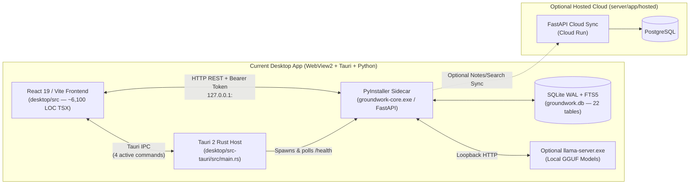
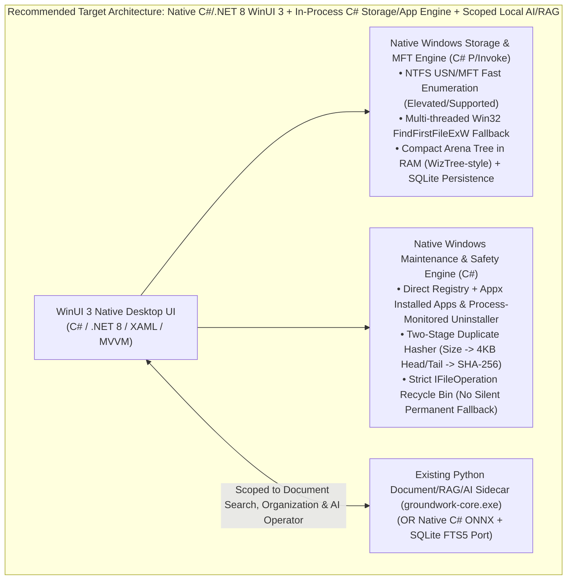

# Groundwork 1.0 — Native Windows Product Readiness & Legacy Cleanup Audit

**Audit Mode:** Strictly Read-Only (Zero repository modifications, zero dependency installations, all uncommitted work preserved)  
**Audit Date:** 2026-10-23  
**Target Repository:** `c:/Users/ttnha/Documents/projects/Groundwork`

---

## 1. Current Architecture & Verified Capabilities

Groundwork is currently structured as a **three-process hybrid desktop/web system** plus a separate marketing website and optional hosted cloud sync service:



### 1.1 Component Mapping
1. **Desktop Frontend (`desktop/src/`)**:
   - **WebView2 React 19 SPA** rendered inside a Tauri window ([`App.tsx`](file:///c:/Users/ttnha/Documents/projects/Groundwork/desktop/src/App.tsx#L28-L295)).
   - **Active Views (20 components, ~6,100 LOC)**:
     - **Files & Storage Explorer**: [`ExplorerWorkspace.tsx`](file:///c:/Users/ttnha/Documents/projects/Groundwork/desktop/src/components/folders/ExplorerWorkspace.tsx#L25-L470), [`FoldersView.tsx`](file:///c:/Users/ttnha/Documents/projects/Groundwork/desktop/src/components/folders/FoldersView.tsx#L7-L118) (`AddFolderDialog`), [`StorageInsightsModal.tsx`](file:///c:/Users/ttnha/Documents/projects/Groundwork/desktop/src/components/folders/StorageInsightsModal.tsx#L1-L384), [`FilePreviewView.tsx`](file:///c:/Users/ttnha/Documents/projects/Groundwork/desktop/src/components/folders/FilePreviewView.tsx#L1-L93).
     - **Storage Analyzer & Cleanup (Uncommitted new view)**: [`CleanupView.tsx`](file:///c:/Users/ttnha/Documents/projects/Groundwork/desktop/src/components/cleanup/CleanupView.tsx#L38-L770) — drive capacity cards, proportional space map, largest folders/files, rule-based cleanup scanner (`exact_duplicates`, `temp_and_logs`, `cache_and_build`, `installers_and_archives`, `large_stale_files`), and token-confirmed deletion modal.
     - **Computer & Installed Apps (Uncommitted expansion)**: [`ComputerView.tsx`](file:///c:/Users/ttnha/Documents/projects/Groundwork/desktop/src/components/computer/ComputerView.tsx#L19-L251) and [`InstalledApps.tsx`](file:///c:/Users/ttnha/Documents/projects/Groundwork/desktop/src/components/computer/InstalledApps.tsx#L1-L859) — live CPU/RAM/battery/drive telemetry, installed app catalog, guided uninstaller, and post-uninstall leftover scanner.
     - **AI Assistant & Organization**: [`AssistantView.tsx`](file:///c:/Users/ttnha/Documents/projects/Groundwork/desktop/src/components/assistant/AssistantView.tsx#L1-L506), [`LocalAISetup.tsx`](file:///c:/Users/ttnha/Documents/projects/Groundwork/desktop/src/components/assistant/LocalAISetup.tsx#L1-L283), [`OrganizeView.tsx`](file:///c:/Users/ttnha/Documents/projects/Groundwork/desktop/src/components/assistant/OrganizeView.tsx#L1-L1120).
     - **Secondary Workspace Tools**: [`CollectionsView.tsx`](file:///c:/Users/ttnha/Documents/projects/Groundwork/desktop/src/components/collections/CollectionsView.tsx#L1-L171), [`ProjectsView.tsx`](file:///c:/Users/ttnha/Documents/projects/Groundwork/desktop/src/components/projects/ProjectsView.tsx#L1-L391), [`ActivityTimelineView.tsx`](file:///c:/Users/ttnha/Documents/projects/Groundwork/desktop/src/components/activity/ActivityTimelineView.tsx#L1-L398), [`ContextSessionsView.tsx`](file:///c:/Users/ttnha/Documents/projects/Groundwork/desktop/src/components/sessions/ContextSessionsView.tsx#L1-L543), [`NotesView.tsx`](file:///c:/Users/ttnha/Documents/projects/Groundwork/desktop/src/components/notes/NotesView.tsx#L1-L496), [`GlobalSearchModal.tsx`](file:///c:/Users/ttnha/Documents/projects/Groundwork/desktop/src/components/search/GlobalSearchModal.tsx#L1-L598), [`SettingsView.tsx`](file:///c:/Users/ttnha/Documents/projects/Groundwork/desktop/src/components/settings/SettingsView.tsx#L1-L113), [`AISettingsView.tsx`](file:///c:/Users/ttnha/Documents/projects/Groundwork/desktop/src/components/settings/AISettingsView.tsx#L1-L242), [`AccountView.tsx`](file:///c:/Users/ttnha/Documents/projects/Groundwork/desktop/src/components/account/AccountView.tsx#L1-L161), [`AccountDialog.tsx`](file:///c:/Users/ttnha/Documents/projects/Groundwork/desktop/src/components/account/AccountDialog.tsx#L1-L287).

2. **Tauri / Rust Host (`desktop/src-tauri/`)**:
   - [`main.rs`](file:///c:/Users/ttnha/Documents/projects/Groundwork/desktop/src-tauri/src/main.rs#L32-L169) allocates an ephemeral loopback port (`127.0.0.1:0`), generates a UUIDv4 bearer token (`GROUNDWORK_CORE_TOKEN`), spawns the Python sidecar (`groundwork-core.exe`), and blocks up to 60 iterations (200ms sleep + 500ms HTTP timeout) polling `GET /health`.
   - Manages single-instance window activation, global shortcut (`Ctrl+Space`), native folder/file dialogs via `rfd`, and child process-tree termination via `taskkill.exe /PID <id> /T /F` ([`main.rs`](file:///c:/Users/ttnha/Documents/projects/Groundwork/desktop/src-tauri/src/main.rs#L15-L30)).
   - [`scanner.rs`](file:///c:/Users/ttnha/Documents/projects/Groundwork/desktop/src-tauri/src/scanner.rs#L20-L91) contains a 90-line single-threaded `std::fs::read_dir` counter exposed as `scan_workspace_fast`, which is **dead code** (never invoked by the frontend or backend).

3. **Python Backend (`server/`)**:
   - **Four Entrypoints**:
     - [`core_entry.py`](file:///c:/Users/ttnha/Documents/projects/Groundwork/server/core_entry.py#L1-L12): Packaged PyInstaller entrypoint running `app.local_main:app` on `127.0.0.1`.
     - [`local_main.py`](file:///c:/Users/ttnha/Documents/projects/Groundwork/server/app/local_main.py#L1-L130): Local FastAPI app, DPAPI preferences loader, SQLite schema initializer, `WatcherService`, and `IndexerService` lifespan manager.
     - [`hosted/main.py`](file:///c:/Users/ttnha/Documents/projects/Groundwork/server/app/hosted/main.py#L1-L101): Cloud Run FastAPI app for optional notes/saved-searches sync and Google OAuth.
     - [`main.py`](file:///c:/Users/ttnha/Documents/projects/Groundwork/server/app/main.py#L1-L11): Dispatcher switching between `local_main` and `hosted.main`.
   - **SQLite Database ([`local_db.py`](file:///c:/Users/ttnha/Documents/projects/Groundwork/server/app/database/local_db.py#L65-L391))**: 17 relational tables + 2 FTS5 virtual tables (`fts_files`, `fts_chunks`) in WAL mode (`SCHEMA_VERSION = 2`) with automatic pre-migration `.bak` hot backup.

4. **AI Operator & Local-First Operation**:
   - **100% Offline Core**: Storage overview, cleanup rules, duplicate detection, file organization, lexical search, bundled ONNX semantic search (`all-MiniLM-L6-v2` in `server/models/minilm`), and app uninstallation work with zero internet access and zero API keys.
   - **Deterministic Local Operator ([`context_engine.py`](file:///c:/Users/ttnha/Documents/projects/Groundwork/server/app/services/ai/context_engine.py#L72-L254))**: Matches storage, cleanup, and app queries via regex (`_detect_operator_intent`), calls local Python services directly, and returns verified citations (`provider_used="local-operator"`) without needing an LLM.
   - **Local GGUF Runtime ([`local_ai_service.py`](file:///c:/Users/ttnha/Documents/projects/Groundwork/server/app/services/local_ai_service.py#L1-L555))**: On-demand download or import of `llama-server.exe` + GGUF models (`Qwen2.5-0.5B`, `Qwen2.5-1.5B`, `Qwen3-4B`) managed via Windows Job Objects ([`process_lifetime.py`](file:///c:/Users/ttnha/Documents/projects/Groundwork/server/app/services/process_lifetime.py#L1-L66)).

---

## 2. Gap Analysis Against the 1.0 Product Goal

| 1.0 Product Requirement | Current Implementation State | Gap Severity | Key Architectural Gap |
| :--- | :--- | :---: | :--- |
| **Native Windows UI (No WebView)** | React 19 + Vite inside Tauri WebView2 (`desktop/src/`) | **CRITICAL BLOCKER** | Entire UI is HTML/CSS/TSX running in Edge WebView2 (`EBWebView`). Must be replaced with native C# / .NET 8 + WinUI 3 (Windows App SDK). |
| **Whole-Drive Discovery & Automatic Scanning** | Manual folder registration (`workspaces` table); drives shown only as read-only bars (`drives.slice(0, 2)`) | **CRITICAL BLOCKER** | Users cannot click a drive to scan it; `CleanupView` tells users to *"Add a folder in Files"*. Drive list truncates to 2 drives in [`ComputerView.tsx`](file:///c:/Users/ttnha/Documents/projects/Groundwork/desktop/src/components/computer/ComputerView.tsx#L198) and [`CleanupView.tsx`](file:///c:/Users/ttnha/Documents/projects/Groundwork/desktop/src/components/cleanup/CleanupView.tsx#L292). |
| **WizTree / WinDirStat-Class Fast Storage Analysis** | Python single-threaded `os.scandir` writing every file row to SQLite (`~2,567 files/sec`) | **CRITICAL BLOCKER** | Zero NTFS MFT (`$MFT` / `FSCTL_ENUM_USN_DATA`) support. On a 1M–2M file system drive, Python `os.scandir` + SQLite row upserts will take 6–15+ minutes and consume 1.5–3+ GB RAM in Python dicts/sets. |
| **Strict Separation of Metadata Scan, Hashing, Indexing & Leftovers** | Partially separated, but critically entangled at key entrypoints | **HIGH BLOCKER** | 1) Adding/refreshing a location in [`api.py`](file:///c:/Users/ttnha/Documents/projects/Groundwork/server/app/routers/api.py#L395) triggers full `IndexerService` (AST + ONNX embeddings + `os.walk` + `watchfiles` on root).<br>2) `CleanupService.scan_cleanup_candidates` synchronously calls `DuplicateService().find_duplicates()`, hashing all colliding files inline.<br>3) `storage_overview` and `scan_cleanup_candidates` synchronously run `inventory.scan()` if unindexed. |
| **Safe Deletion & Cleanup Safeguards** | Token-confirmed (`propose` → `execute`), but has a silent permanent-delete fallback and symlink/path flaws | **CRITICAL BLOCKER** | 1) [`CleanupService.execute_cleanup`](file:///c:/Users/ttnha/Documents/projects/Groundwork/server/app/services/cleanup_service.py#L687-L695) **silently falls back to permanent `shutil.rmtree` / `unlink()`** when `mode == "recycle"` fails.<br>2) [`_is_protected_system_path`](file:///c:/Users/ttnha/Documents/projects/Groundwork/server/app/services/cleanup_service.py#L95) gates `PROTECTED_WINDOWS_NAMES` behind `len(resolved.parts) <= 2`, failing to protect `C:\Windows\System32` (3 parts).<br>3) `validate_workspace_path` calls `.resolve()`, following symlinks/junctions instead of refusing or unlinking the link itself. |
| **Revo-Style Application Uninstaller & Leftover Scanning** | PowerShell app enumeration + `Popen` uninstaller + shallow 6-folder/HKCU leftover scan | **HIGH BLOCKER** | 1) `list_apps` spawns PowerShell + compiles inline C# `System.Drawing` icon extractor (~3–15s blocking).<br>2) `execute_uninstall` does not wait for or monitor the uninstaller process tree before enabling leftover scanning.<br>3) Leftover scan misses `HKLM`, Start Menu shortcuts, `%TEMP%`, services/tasks, and cannot delete registry leftovers or custom `InstallLocation` outside the 6 default roots. |
| **Local-First Operation** | Core works offline; optional cloud sync & optional cloud AI keys | **MEDIUM GAP** | [`update_preferences`](file:///c:/Users/ttnha/Documents/projects/Groundwork/server/app/routers/api.py#L918) rejects `"builtin"` with HTTP 422 (`Unknown provider`), breaking saving Built-in AI in `AISettingsView`. First-launch modal (`AccountDialog.tsx`) still foregrounds cloud account sign-in. |
| **Clean-Machine Packaging & Installer Readiness** | PyInstaller `--onedir` + Tauri NSIS installer (~170 MB compressed) | **HIGH GAP** | 1) `prepare-git.ps1` bundles ~35 MB of unused Avalonia/SkiaSharp/MSAL/TclTk DLLs into `server/git/`.<br>2) Moving to WinUI 3 requires replacing Tauri's bundler with a native Windows build + NSIS/MSI installer. |

---

## 3. Critical 1.0 Blockers (Ranked by Severity)

### P0 — Must Fix (Release-Blocking Architecture & Safety Flaws)

1. **[P0-ARCH] WebView2 / React / Tauri UI Must Be Replaced with Native WinUI 3**
   - **Evidence:** [`desktop/src/`](file:///c:/Users/ttnha/Documents/projects/Groundwork/desktop/src/App.tsx) is a React 19 SPA hosted in Tauri's WebView2 control.
   - **Impact:** Violates the core 1.0 product requirement for a native Windows experience without a WebView interface.

2. **[P0-SAFETY] Silent Permanent Deletion Fallback When Recycle Bin Mode Fails**
   - **Evidence:** [`server/app/services/cleanup_service.py#L687-L695`](file:///c:/Users/ttnha/Documents/projects/Groundwork/server/app/services/cleanup_service.py#L687-L695):
     ```python
     if mode == "recycle":
         recycled = _send_to_recycle_bin_windows(target)
         if not recycled:
             if is_dir:
                 shutil.rmtree(target)
             else:
                 target.unlink()
             used_method = "permanent_fallback"
     ```
   - **Impact:** When a user explicitly selects **Send to Recycle Bin (Safer)**, any failure in `SHFileOperationW` (e.g., path > 260 chars, network/removable drive, file larger than Recycle Bin quota, or shell lock) causes Groundwork to **permanently destroy the file or directory tree without user consent**.

3. **[P0-SAFETY] Broken System Directory Protection & Symlink Resolution in Cleanup**
   - **Evidence:**
     - [`server/app/services/cleanup_service.py#L70-L96`](file:///c:/Users/ttnha/Documents/projects/Groundwork/server/app/services/cleanup_service.py#L70-L96): `PROTECTED_WINDOWS_NAMES` includes `"system32"` and `"syswow64"`, but line 95 checks `if len(resolved.parts) <= 2 and resolved.name.lower() in PROTECTED_WINDOWS_NAMES:`. Because `Path("C:/Windows/System32").parts` has length `3` (`('C:\\', 'Windows', 'System32')`), `C:\Windows\System32` and all subdirectories of `C:\Windows` bypass `_is_protected_system_path`!
     - [`server/app/core/security.py#L64-L76`](file:///c:/Users/ttnha/Documents/projects/Groundwork/server/app/core/security.py#L64-L76): `validate_workspace_path` calls `Path(path_str).resolve()`, which traverses symlinks and NTFS junctions. Deleting a junction or symlink via `CleanupService` resolves and deletes the **target directory contents** rather than unlinking the reparse point.

4. **[P0-SCAN] No Whole-Drive Discovery/Scan Workflow & Coupled Full-Drive Watcher/Indexer**
   - **Evidence:**
     - [`CleanupView.tsx#L208-L223`](file:///c:/Users/ttnha/Documents/projects/Groundwork/desktop/src/components/cleanup/CleanupView.tsx#L208-L223) requires manual folder addition before any analysis works, and [`CleanupView.tsx#L292`](file:///c:/Users/ttnha/Documents/projects/Groundwork/desktop/src/components/cleanup/CleanupView.tsx#L292) / [`ComputerView.tsx#L198`](file:///c:/Users/ttnha/Documents/projects/Groundwork/desktop/src/components/computer/ComputerView.tsx#L198) slice the drive list to `drives.slice(0, 2)`.
     - [`api.py#L395`](file:///c:/Users/ttnha/Documents/projects/Groundwork/server/app/routers/api.py#L395) and [`watcher_service.py#L87-L95`](file:///c:/Users/ttnha/Documents/projects/Groundwork/server/app/services/watcher_service.py#L87-L95): Adding `C:\` as a workspace immediately starts an OS recursive file watcher (`watchfiles`) on `C:\` and triggers `IndexerService` content/embedding indexing across the entire drive.
     - [`inventory_service.py#L195-L198`](file:///c:/Users/ttnha/Documents/projects/Groundwork/server/app/services/inventory_service.py#L195-L198): Any `PermissionError` during a scan (guaranteed on `C:\System Volume Information` or `C:\Windows\System32\config`) forces `InventoryService._scan` to discard its in-memory folder rollup and reload all file and folder rows from SQLite via `refresh_folder_sizes()`.

5. **[P0-PERF] Single-Threaded Python `os.scandir` + Full-Table In-Memory Dicts Cannot Scale to Whole Drives**
   - **Evidence:** [`inventory_service.py#L75-L93`](file:///c:/Users/ttnha/Documents/projects/Groundwork/server/app/services/inventory_service.py#L75-L93) loads all existing `inventory` rows into `existing_cache`, stores all paths in `seen_paths`, `all_folders`, and `folder_parents`, and writes 2,000-row SQLite upsert batches from a single Python thread (`2,567 files/sec` measured). Zero NTFS MFT (`FSCTL_ENUM_USN_DATA` / `$MFT`) or multi-threaded Win32 `FindFirstFileExW` (`FindExInfoBasic`) engine exists.

---

### P1 — High-Priority Product & Reliability Blockers

6. **[P1-PERF] Duplicate & Cleanup Scanning Reads Full File Streams Synchronously Without Pre-Hashing, Cloud-Placeholder Guards, or SQLite Variable Limits**
   - **Evidence:**
     - [`duplicate_service.py#L63-L70`](file:///c:/Users/ttnha/Documents/projects/Groundwork/server/app/services/duplicate_service.py#L63-L70): Builds `WHERE size_bytes IN (?, ?, ...)` with one bind parameter per colliding file size. On a full drive with >32,766 colliding file sizes, SQLite throws `OperationalError: too many SQL variables`.
     - [`duplicate_service.py#L96-L100`](file:///c:/Users/ttnha/Documents/projects/Groundwork/server/app/services/duplicate_service.py#L96-L100): Reads 100% of every size-colliding file from byte 0 to EOF with no 4 KB head/tail pre-hash, no persistent hash cache, and **no check for `CLOUD_PLACEHOLDER_MASK`** (`FILE_ATTRIBUTE_OFFLINE | FILE_ATTRIBUTE_RECALL_ON_DATA_ACCESS`), which will trigger OneDrive/iCloud hydration and hang HTTP requests past the 15s timeout.
     - [`cleanup_service.py#L483`](file:///c:/Users/ttnha/Documents/projects/Groundwork/server/app/services/cleanup_service.py#L483): `scan_cleanup_candidates()` calls `DuplicateService().find_duplicates()` synchronously on every rule scan, and ignores `hard_link_aliases` (`L485-509`), proposing hard-linked files for deletion even though deleting one reclaims 0 bytes.

7. **[P1-APPS] Uninstaller Process Monitoring, Leftover Scope & Custom InstallLocation Deletion Bug**
   - **Evidence:**
     - [`installed_apps.py#L410-L423`](file:///c:/Users/ttnha/Documents/projects/Groundwork/server/app/services/installed_apps.py#L410-L423): `execute_uninstall` spawns `subprocess.Popen(argv, shell=False)` and returns immediately (`status="launched"`) without monitoring process completion. Users prompted to click "Scan for Leftovers" immediately will scan while the uninstaller is still running.
     - [`installed_apps.py#L715-L734`](file:///c:/Users/ttnha/Documents/projects/Groundwork/server/app/services/installed_apps.py#L715-L734): `propose_leftover_cleanup` only allows paths under the 6 default roots (`%LOCALAPPDATA%`, `%APPDATA%`, `%PROGRAMDATA%`, `%ProgramFiles%`, `%ProgramFiles(x86)%`) plus registered workspaces. If `scan_app_leftovers` finds a leftover `InstallLocation` on `D:\Games\MyApp` or `C:\Tools\MyApp`, `propose_leftover_cleanup` fails with `PermissionError` because `install_location` is not passed in `extra_roots`!
     - [`installed_apps.py#L655-L687`](file:///c:/Users/ttnha/Documents/projects/Groundwork/server/app/services/installed_apps.py#L655-L687): Registry leftover detection only checks 3 exact keys under `HKCU\Software` and is read-only (no `.reg` backup + confirmed deletion).

8. **[P1-BUG] Built-in Local AI Provider Rejected by `PUT /api/system/preferences` & Timeout Bug in `getInstalledApps`**
   - **Evidence:**
     - [`server/app/routers/api.py#L918`](file:///c:/Users/ttnha/Documents/projects/Groundwork/server/app/routers/api.py#L918): `if values.get("ai_provider") not in {None, "local", "ollama", "openai", "gemini"}` omits `"builtin"`, causing `AISettingsView` (`choice = "builtin"`) to fail with HTTP 422 when saving.
     - [`desktop/src/services/api.ts#L207-L208`](file:///c:/Users/ttnha/Documents/projects/Groundwork/desktop/src/services/api.ts#L207-L208): `AbortSignal.any([options.signal, AbortSignal.timeout(15000)])` aborts when *either* signal fires, so `getInstalledApps`'s 70-second timeout (`api.ts:380`) is always killed at 15 seconds on slow cold PowerShell runs.

---

## 4. Evidence-Based Performance Findings & Unmeasured Assumptions

### 4.1 Measured Performance (From Repository Benchmarks & Validation Logs)
| Operation | Workload | Measured Result | Source Evidence |
| :--- | :--- | :--- | :--- |
| **Python `InventoryService.scan` (Cold)** | 53,112 files, 7,027 dirs (12.3 GB) on NVMe | **20.68 s** (`2,567.4 files/sec`), 17.89 ms to first 64 rows | [`docs/INVENTORY_SCANNING_PERFORMANCE.md#L60-L68`](file:///c:/Users/ttnha/Documents/projects/Groundwork/docs/INVENTORY_SCANNING_PERFORMANCE.md#L60-L68) |
| **Python `InventoryService.scan` (Incremental)** | 53,112 unchanged files | **10.05 s** (`5,283 files/sec`, 0 DB writes) | [`docs/INVENTORY_SCANNING_PERFORMANCE.md#L64`](file:///c:/Users/ttnha/Documents/projects/Groundwork/docs/INVENTORY_SCANNING_PERFORMANCE.md#L64) |
| **Python `InventoryService.scan` (25k stress)** | 25,000 files + ACL denial + WAL recovery | **1.11 s – 1.45 s** recovery scan | [`docs/RELEASE_1_0_READINESS.md#L25,L44`](file:///c:/Users/ttnha/Documents/projects/Groundwork/docs/RELEASE_1_0_READINESS.md#L25) |
| **Rust `scanner.rs` (Unwired prototype, debug)** | 53,110 files, 7,027 dirs | **6.51 s** (`8,157 files/sec`, counts only, no DB) | [`docs/INVENTORY_SCANNING_PERFORMANCE.md#L69`](file:///c:/Users/ttnha/Documents/projects/Groundwork/docs/INVENTORY_SCANNING_PERFORMANCE.md#L69) |
| **SQLite `browse()` folder query** | 53,112 file inventory | **< 1 ms** (using pre-rolled `size_bytes` and `file_count`) | [`docs/INVENTORY_SCANNING_PERFORMANCE.md#L66`](file:///c:/Users/ttnha/Documents/projects/Groundwork/docs/INVENTORY_SCANNING_PERFORMANCE.md#L66) |
| **Content Indexing (`IndexerService`)** | 10,001 documents (AST + ONNX MiniLM embeddings) | **343.98 s** (~5.7 minutes, ~29 docs/sec) | [`docs/RELEASE_1_0_READINESS.md#L26`](file:///c:/Users/ttnha/Documents/projects/Groundwork/docs/RELEASE_1_0_READINESS.md#L26) |

### 4.2 Unmeasured Assumptions & Extrapolated Bottlenecks (Honest Labeling)
- **Whole-Drive Scan (500k – 2M files on `C:\`) — UNMEASURED:**
  - *Extrapolation from measured 2,567 files/sec:* Scanning a 1,000,000-file Windows system drive with the current Python `InventoryService` will take **~6.5 minutes** (versus **1.5–4 seconds** in WizTree via NTFS MFT/USN or **10–25 seconds** in parallel native Win32 traversal).
  - *Memory:* Storing `existing_cache`, `seen_paths`, `all_folders`, and `folder_parents` in Python dicts/sets for 1M–2M paths is unmeasured, but Python `str` + dict/set overhead for 4M+ path entries will consume **~1.5 GB – 3.0 GB RAM**.
- **Cold Startup Latency (`main.rs` -> `groundwork-core.exe`) — UNMEASURED:**
  - PyInstaller `--onedir` loading Python + FastAPI + Uvicorn + SQLite + `watchfiles` + `onnxruntime` is polled every 200ms in [`main.rs#L70-L84`](file:///c:/Users/ttnha/Documents/projects/Groundwork/desktop/src-tauri/src/main.rs#L70-L84), adding **~1.5–4.0 seconds** of cold-start delay before the UI can render data.
- **Installed Apps Enumeration Latency (`installed_apps.py`) — UNMEASURED ON LARGE APP CATALOGS:**
  - Spawning `powershell.exe -STA`, compiling C# `System.Drawing` via `Add-Type`, and extracting 48×48 PNG icons for every item in `shell:AppsFolder` on cold cache takes several seconds and has no progressive streaming.
- **Semantic Search over >50,000 Chunks — UNMEASURED:**
  - [`search_engine.py#L325-L368`](file:///c:/Users/ttnha/Documents/projects/Groundwork/server/app/services/search_engine.py#L325-L368) (`_search_semantic`) executes `SELECT ... embedding_json FROM chunks`, runs `json.loads()` on every row in Python, and computes cosine similarity in a pure Python loop. Beyond ~50k chunks, this will bottleneck CPU and memory.

---

## 5. Recommended Target Architecture & Migration Strategy

### 5.1 Evaluate Backend Consolidation vs. Hybrid Keep
You highlighted a critical architectural rule: **"My preference for your stated requirements is C# + WinUI 3 for the native UI, with a dedicated scanning engine using Windows filesystem APIs. Rust is also a strong option for performance-critical scanning, but don't maintain multiple backend technologies without a clear reason."**

Currently, Groundwork maintains **three languages** on the desktop (`TypeScript/React` + `Rust/Tauri` + `Python/FastAPI`).
- If we replace React/Tauri with **C#/.NET 8 + WinUI 3**, keeping Rust (`src-tauri`) makes **zero sense**—Rust in Groundwork is only 169 lines of process-spawning boilerplate (`main.rs`) and 90 lines of unused directory walking (`scanner.rs`). **Rust/Tauri should be 100% removed.**
- What about **C#/.NET 8 vs. Python**? Let's evaluate the two viable target architectures:



#### Architecture Decision Matrix

| Responsibility | Where It Should Live in 1.0 | Why |
| :--- | :--- | :--- |
| **Desktop UI Shell, TreeViews, Treemap/Space Map, Dialogs, System Tray, Hotkeys** | **C# / .NET 8 + WinUI 3** | Eliminates WebView2 (`EBWebView`), Node/Vite, and Tauri/Rust completely. Native Windows 11 Mica/Acrylic styling, virtualized `TreeView`/`ListView`, zero startup WebView overhead. |
| **Whole-Drive Discovery, NTFS MFT/USN Scanning & Parallel Win32 Directory Fallback** | **C# / .NET 8 Native Scanning Engine (In-Process via Win32 P/Invoke)** | C# `LibraryImport` / P/Invoke to `DeviceIoControl` (`FSCTL_ENUM_USN_DATA` / `$MFT`) and parallel `FindFirstFileExW` (`FindExInfoBasic`) with a compact struct array in memory achieves **WizTree/WinDirStat speeds (1–3s MFT, 5–10s Win32 fallback for 1M files)** with live UI progress and zero HTTP/JSON serialization overhead between Python and UI. |
| **Duplicate Hashing, Cleanup Execution (`IFileOperation`), Installed Apps & Uninstaller Monitoring** | **C# / .NET 8 Native Maintenance Engine** (or hardened Python during transition, migrated to C#) | Reading `HKLM`/`HKCU` Uninstall keys, `PackageManager` (Appx), `SHCreateItemFromParsingName` icons, `Process.WaitForExitAsync` on vendor uninstallers, and COM `IFileOperation` (Recycle Bin without `MAX_PATH` limits or silent permanent fallback) are native Win32/.NET APIs. Doing them in C# eliminates the slow PowerShell subprocess (`installed_apps.py`)! |
| **Document Parsing (`.pdf`, `.docx`, `.xlsx`, `.pptx`), AST Chunking, ONNX Embeddings, & AI Operator** | **Preserve Python `groundwork-core` Sidecar (Phase 1) OR Port to C# (`Microsoft.ML.OnnxRuntime` + `Sqlite` FTS5)** | Groundwork's Python RAG engine (`AIContextEngine`, `CitationVerifier`, `OrganizationService`, `FileParser`, `LocalAIService`) is well-tested (159+ tests passing). **Recommendation:** Preserve `groundwork-core` initially *only* for scoped workspace document indexing, organization, and AI operator queries (started lazily or in background), while moving **whole-drive scanning, duplicates, cleanup, and installed apps** into the native C#/.NET 8 engine—or port the remaining SQLite/ONNX services to C# if you want a single-binary, zero-Python distribution. |

### 5.2 Whole-Drive Scanning Design (NTFS MFT/USN + Parallel Win32 Fallback)
To achieve WizTree/WinDirStat performance while handling standard-user vs. elevated permissions cleanly:
1. **Automatic Drive Discovery (`DriveInfo.GetDrives()`):**
   - Automatically enumerate all fixed, removable, and network drives (`C:\`, `D:\`, etc.) on launch—no manual "Add Folder" step required.
   - Display filesystem type (`NTFS`, `ReFS`, `exFAT`, `FAT32`), total/used/free bytes, and a primary **"Scan Drive"** / **"Scan All Local Drives"** action.
2. **Tier 1 — Accelerated NTFS USN/MFT Enumeration (When Supported & Permitted):**
   - On local `NTFS` volumes when running with Administrator privileges (or via an optional on-demand elevated scanner helper process), open `\\.\C:` with `CreateFileW` and enumerate file records via `FSCTL_ENUM_USN_DATA` (`MFT_ENUM_DATA_V0`) + `FSCTL_GET_NTFS_VOLUME_DATA` / `$MFT` attribute records to resolve `(FileReferenceNumber, ParentFileReferenceNumber, FileSize, AllocatedSize, FileAttributes, FileName)` in **1–3 seconds for 1M+ files**.
3. **Tier 2 — Multi-Threaded Win32 `FindFirstFileExW` Fallback (Standard User / Non-NTFS / Network):**
   - When running without elevation, or on `exFAT`/`FAT32`/`ReFS`/SMB shares, or for directories where MFT parent reconstruction encounters restricted subtrees, use a work-stealing thread pool (`Parallel.ForEach` / `Channel<DirectoryWorkItem>`) calling `FindFirstFileExW` with `FindExInfoBasic` and `FIND_FIRST_EX_LARGE_FETCH`.
   - Never follow reparse points (`FILE_ATTRIBUTE_REPARSE_POINT`). Never open file streams (`CLOUD_PLACEHOLDER_MASK` safe).
   - Aggregate sizes in a compact contiguous struct array (`NodeIndex`, `ParentIndex`, `LogicalBytes`, `AllocatedBytes`, `FileCount`) rather than inserting 2 million individual rows into SQLite during the scan.

---

## 6. Feature-by-Feature Preservation / Replacement Plan

| Feature Area | Current Implementation | Target Action | Details |
| :--- | :--- | :---: | :--- |
| **Desktop Window, Navigation, Split Panes, Dark/Light Theme** | `desktop/src/App.tsx`, `DesktopCommandBar.tsx`, `tokens.css`, `main.rs` | **Replace** | Build native C#/.NET 8 WinUI 3 shell (`MainWindow.xaml`, `NavigationView` / CommandBar, single-instance activation, `RegisterHotKey` for `Ctrl+Space`). |
| **Whole-Drive & Folder Storage Analyzer + Visual Space Map** | `InventoryService`, `CleanupService.storage_overview`, `ExplorerWorkspace.tsx`, `CleanupView.tsx` | **Replace / Migrate** | Replace Python `os.scandir` whole-drive crawl with native C# MFT + parallel Win32 scanner; build native WinUI 3 virtualized TreeList + interactive Treemap / Space Map control. |
| **Duplicate File Detection** | `DuplicateService` (`duplicate_service.py`), `StorageInsightsModal.tsx` | **Migrate & Harden** | Decouple from `scan_cleanup_candidates`. Implement 3-stage pipeline: (1) Size collision (>0 bytes, skip cloud placeholders & hard-link aliases), (2) 4 KB first+last block fast hash (`xxHash64` or `SHA-256`), (3) Full SHA-256 + NTFS ADS stream hash with progress & cancellation. |
| **Rule-Based Junk & System Cleanup** | `CleanupService` (`cleanup_service.py`), `CleanupView.tsx` | **Migrate & Harden** | Expand rules beyond manually added workspaces to include standard Windows cleanup locations (`%TEMP%`, `%LOCALAPPDATA%\Temp`, Windows Error Reporting dumps, Thumbnail cache, Browser caches) with risk tiers and zero silent permanent fallback. |
| **Installed Apps, Guided Uninstaller & Leftover Scanner** | `installed_apps.py` (PowerShell script), `InstalledApps.tsx` | **Replace (Native Win32/.NET) & Harden** | Replace slow PowerShell subprocess with direct C# `Microsoft.Win32.Registry` + `Windows.Management.Deployment.PackageManager` + native shell icon extraction. Monitor uninstaller PID (`Process.WaitForExitAsync`) + child processes before triggering leftover scan. Add `.reg` backup before any optional registry leftover removal. |
| **Safe File Organization & Undo Journal** | `OrganizationService` (`organization_service.py`) + `windows_files.py`, `OrganizeView.tsx` | **Keep / Migrate UI** | **Preserve `OrganizationService` & `windows_files.py`**—this is the highest-quality, best-tested subsystem in Groundwork (atomic JSON plan journals, `CopyFileExW`, NTFS ADS + DACL preservation, full undo). Expose in WinUI 3. |
| **Hybrid Document Search (FTS5 + ONNX MiniLM) & File Reader** | `IndexerService`, `SearchEngine`, `EmbeddingService`, `PreviewService`, `FilePreviewView.tsx` | **Keep (Scoped to User Folders)** | Keep content indexing strictly scoped to user-selected document/project folders (never whole-drive `C:\`). Remove dead `fts_files` writes. Render previews in native WinUI 3 reader view. |
| **AI Operator & Local GGUF Runtime** | `AIContextEngine`, `CitationVerifier`, `LocalAIService`, `AssistantView.tsx` | **Keep & Fix Bug** | Preserve `local-operator` deterministic intent engine, `CitationVerifier`, and `llama-server.exe` Job Object manager. Fix `api.py:918` so `"builtin"` provider saves properly. |
| **Projects, Git History, Notes, Collections, Activity, Sessions** | `project_service.py`, `git_service.py`, `notes_service.py`, `collection_service.py`, `activity_service.py`, `context_service.py` | **Keep Backend / Migrate UI** | Keep SQLite tables and services; expose in secondary WinUI 3 navigation views. Trim 35 MB of unused DLLs from `server/git/`. |
| **Optional Cloud Sync (`hosted/`)** | `server/app/hosted/*`, `sync_service.py`, `google_signin_service.py` | **Keep Optional (De-emphasize on Launch)** | Do not prompt for cloud sign-in on first launch (`AccountDialog`). Keep cloud sync strictly optional inside Settings. |
| **Public Marketing & Release Website (`client/`)** | `client/` (Vite/React static site) | **Keep** | Separate web portal for downloads and docs; update screenshots once WinUI 3 UI is complete. |

---

## 7. Safety, Deletion, Uninstall & Recovery Audit Summary

| Safety Control | Current Status | Audit Finding & Required 1.0 Fix |
| :--- | :---: | :--- |
| **Token Confirmation (`propose` → `execute`)** | **Verified Working** | Single-use HMAC/UUID confirmation tokens with 300s TTL in [`security.py#L88-L114`](file:///c:/Users/ttnha/Documents/projects/Groundwork/server/app/core/security.py#L88-L114) verify `action_type` and exact `proposal` payload. Keep this pattern. |
| **Recycle Bin Deletion (`mode="recycle"`)** | **UNSAFE FALLBACK** | [`cleanup_service.py#L687-L695`](file:///c:/Users/ttnha/Documents/projects/Groundwork/server/app/services/cleanup_service.py#L687-L695) silently runs `shutil.rmtree` / `target.unlink()` if `SHFileOperationW` returns false. **Fix:** Remove the silent permanent fallback immediately. If Recycle Bin fails on a path, record it in `failed` with reason `"Recycle Bin unavailable for this path; explicit permanent deletion required"`. Upgrade from legacy `SHFileOperationW` (`MAX_PATH` 260 limit) to COM `IFileOperation`. |
| **Protected Windows Paths Guard** | **BROKEN FOR DEPTH > 2** | [`cleanup_service.py#L95`](file:///c:/Users/ttnha/Documents/projects/Groundwork/server/app/services/cleanup_service.py#L95) checks `len(resolved.parts) <= 2`, which protects `C:\Windows` and `C:\Program Files`, but **does not protect** `C:\Windows\System32`, `C:\Windows\WinSxS`, `C:\Users\<user>\AppData`, or boot/system files (`pagefile.sys`, `hiberfil.sys`, `swapfile.sys`, `bootmgr`). **Fix:** Check ancestor prefixes (`is_relative_to`) against `C:\Windows`, `C:\Program Files`, `C:\Program Files (x86)`, `C:\ProgramData` (except explicit verified app leftover targets), `$Recycle.Bin`, `System Volume Information`, `Recovery`, and User Profile root shell folders (`Desktop`, `Documents`, `Pictures`). |
| **Symlink / Junction / Reparse Point Deletion** | **MISSING IN CLEANUP** | `validate_workspace_path` calls `Path(path_str).resolve()`, following links to their target. **Fix:** Inspect raw path with `os.lstat` / `GetFileAttributesW(FILE_ATTRIBUTE_REPARSE_POINT)` before `.resolve()`. Never recursively `rmtree` into a junction or symlink. |
| **Hard-Link Awareness in Duplicate Cleanup** | **PARTIAL GAP** | [`duplicate_service.py#L122-L130`](file:///c:/Users/ttnha/Documents/projects/Groundwork/server/app/services/duplicate_service.py#L122-L130) detects hard links via `(st_dev, st_ino)`, but [`cleanup_service.py#L485-L509`](file:///c:/Users/ttnha/Documents/projects/Groundwork/server/app/services/cleanup_service.py#L485-L509) strips `_identity` and proposes hard-linked siblings as reclaimable waste. **Fix:** Exclude hard-linked aliases from `exact_duplicates` cleanup candidates or label them clearly as `0 bytes reclaimed unless all links are removed`. |
| **Uninstaller Command Execution** | **Verified Safe** | [`installed_apps.py#L319-L354`](file:///c:/Users/ttnha/Documents/projects/Groundwork/server/app/services/installed_apps.py#L319-L354) rejects shell metacharacters (`&|;<>`\n\r$`) and executes `subprocess.Popen(argv, shell=False)`. **Gap:** Must monitor the spawned PID (and any child processes spawned in `%TEMP%`) until completion before running post-uninstall leftover scan. |
| **Leftover Custom `InstallLocation` Boundary** | **BUG** | [`installed_apps.py#L715-L734`](file:///c:/Users/ttnha/Documents/projects/Groundwork/server/app/services/installed_apps.py#L715-L734): `propose_leftover_cleanup` fails to include the app's verified `install_location` in `extra_roots`, blocking removal of leftovers in custom install paths (e.g. `D:\Apps\Foo`). Conversely, passing entire `%ProgramFiles%` and `%LOCALAPPDATA%` as `extra_allowed_roots` allows any child folder if called directly. **Fix:** Bind leftover cleanup tokens strictly to the exact candidate paths discovered by `scan_app_leftovers()`. |
| **File Move / Organization Rollback** | **Verified Strong** | [`organization_service.py#L283-L455`](file:///c:/Users/ttnha/Documents/projects/Groundwork/server/app/services/organization_service.py#L283-L455) + [`windows_files.py`](file:///c:/Users/ttnha/Documents/projects/Groundwork/server/app/services/windows_files.py) uses durable journal states (`copying` -> `copied` -> `completed`), `CopyFileExW`, SHA-256 + NTFS ADS stream verification before unlinking source, and full undo. |

---

## 8. Windows Packaging & Clean-Machine Readiness Audit

1. **Current Packaging Pipeline ([`build-core.ps1`](file:///c:/Users/ttnha/Documents/projects/Groundwork/desktop/scripts/build-core.ps1), [`build-signed-release.ps1`](file:///c:/Users/ttnha/Documents/projects/Groundwork/desktop/scripts/build-signed-release.ps1)):**
   - Builds `groundwork-core.exe` (`--onedir`) via PyInstaller, stages `server/models/minilm` (~86.9 MB ONNX model) and `server/git/` (~58.0 MB), and bundles everything into an NSIS installer (`Groundwork-windows-x64-setup.exe`, ~169.8 MB).
   - Tested with `PATH=""` in [`smoke-installed.cjs#L23`](file:///c:/Users/ttnha/Documents/projects/Groundwork/desktop/scripts/smoke-installed.cjs#L23), proving zero dependency on system Python, Node, or Git.
2. **Packaging Bloat Identified:**
   - **`server/git/` contains ~35 MB of unused GUI/auth DLLs:** [`desktop/scripts/prepare-git.ps1#L10`](file:///c:/Users/ttnha/Documents/projects/Groundwork/desktop/scripts/prepare-git.ps1#L10) copies `*.dll` from `mingw64/bin`, sweeping in `libSkiaSharp.dll` (9.4 MB), `av_libglesv2.dll` (4.4 MB), `msalruntime.dll` (2.9 MB), `Avalonia.*.dll` (~4 MB), `tcl86.dll`/`tk86.dll` (3.4 MB), `Microsoft.Identity.Client.dll` (1.6 MB), and `libHarfBuzzSharp.dll` (1.6 MB). `git.exe` only needs ~12 core POSIX/crypto/compression DLLs (`libiconv-2.dll`, `libintl-8.dll`, `libpcre2-8-0.dll`, `zlib1.dll`, `libzstd.dll`, `libcrypto-3-x64.dll`, `libssl-3-x64.dll`, `libcurl-4.dll`, `libssp-0.dll`, `libwinpthread-1.dll`, etc.).
   - ** Packaging Venv Installs Cloud & Test Dependencies:** [`build-core.ps1#L7`](file:///c:/Users/ttnha/Documents/projects/Groundwork/desktop/scripts/build-core.ps1#L7) installs `server/requirements.txt`, which includes `psycopg2-binary`, `sqlalchemy`, `PyJWT`, `google-auth`, `requests`, `pytest`, and `pytest-asyncio` even though `app.hosted` and `tests` are excluded from the desktop binary.
   - **Redundant MSI Build in CI:** [`tauri.conf.json#L34`](file:///c:/Users/ttnha/Documents/projects/Groundwork/desktop/src-tauri/tauri.conf.json#L34) sets `"targets": "all"`, building both `.msi` and `.exe` in CI when only the NSIS `.exe` is used.

---

## 9. Comprehensive Legacy Code, Dependency & Repository Cleanup Audit

All findings across the repository are classified below using the five required categories:
- **Keep:** Required by current functionality and the planned native Windows 1.0 architecture.
- **Migrate:** Useful functionality/logic that should move to or be exposed through the native WinUI 3 architecture.
- **Replace:** Valid functionality that should be superseded by a native Windows implementation.
- **Remove:** Demonstrably unused, obsolete, duplicated, or incompatible code/assets.
- **Investigate:** Uncertain cases requiring product owner decision before removal.

### 9.1 Confirmed Obsolete / Dead Code That Can Be Removed (`Remove`)

| Exact Path or Symbol | Category | Reason & Evidence | References Searched | Dependent Functionality & Risks |
| :--- | :---: | :--- | :--- | :--- |
| [`client/src/Providers.tsx`](file:///c:/Users/ttnha/Documents/projects/Groundwork/client/src/Providers.tsx)<br>[`desktop/src/components/ai/AIInvestigationView.tsx`](file:///c:/Users/ttnha/Documents/projects/Groundwork/desktop/src/components/ai/AIInvestigationView.tsx)<br>[`desktop/src/components/common/FileGlyph.tsx`](file:///c:/Users/ttnha/Documents/projects/Groundwork/desktop/src/components/common/FileGlyph.tsx)<br>[`desktop/src/components/folders/FileBrowser.tsx`](file:///c:/Users/ttnha/Documents/projects/Groundwork/desktop/src/components/folders/FileBrowser.tsx)<br>[`desktop/src/components/home/HomeView.tsx`](file:///c:/Users/ttnha/Documents/projects/Groundwork/desktop/src/components/home/HomeView.tsx)<br>[`desktop/src/components/layout/Header.tsx`](file:///c:/Users/ttnha/Documents/projects/Groundwork/desktop/src/components/layout/Header.tsx)<br>[`desktop/src/components/layout/Sidebar.tsx`](file:///c:/Users/ttnha/Documents/projects/Groundwork/desktop/src/components/layout/Sidebar.tsx) | **Remove** | Already deleted (`D`) in working tree (`git status`). Confirmed zero remaining imports across `desktop/` and `client/`. | `git grep` across entire repo for `Providers`, `AIInvestigationView`, `FileGlyph`, `FileBrowser`, `HomeView`, `Header`, `Sidebar`. | None. (`App.tsx:254,258,262` still has harmless `"home"` string checks in tab arrays that should also be cleaned). |
| [`desktop/src/components/ui/Input.tsx`](file:///c:/Users/ttnha/Documents/projects/Groundwork/desktop/src/components/ui/Input.tsx#L1-L65) & export in [`desktop/src/components/ui/index.ts#L4`](file:///c:/Users/ttnha/Documents/projects/Groundwork/desktop/src/components/ui/index.ts#L4) | **Remove** | Confirmed dead React UI component. All views use `<input className="gw-input">` directly. | `git grep Input` across `desktop/src/`. | Zero callers. Safe to remove. |
| [`desktop/src-tauri/src/scanner.rs`](file:///c:/Users/ttnha/Documents/projects/Groundwork/desktop/src-tauri/src/scanner.rs#L1-L110) & `scan_workspace_fast` / `get_platform_info` in [`desktop/src-tauri/src/main.rs#L115-L132`](file:///c:/Users/ttnha/Documents/projects/Groundwork/desktop/src-tauri/src/main.rs#L115-L132) | **Remove** | Confirmed dead Rust code. Registered in `tauri::generate_handler!`, but never called by `desktop/src/` or `server/`. | `git grep scan_workspace_fast` and `git grep get_platform_info` across entire repo. | Only referenced in `scanner.rs` unit test and `docs/INVENTORY_SCANNING_PERFORMANCE.md`. |
| [`server/app/services/ai/investigation.py`](file:///c:/Users/ttnha/Documents/projects/Groundwork/server/app/services/ai/investigation.py#L1-L58), `POST /api/ai/investigate` in [`api.py#L843-L853`](file:///c:/Users/ttnha/Documents/projects/Groundwork/server/app/routers/api.py#L843-L853), `InvestigationRequest` in [`types.py`](file:///c:/Users/ttnha/Documents/projects/Groundwork/server/app/models/types.py), `investigateProblem` in [`api.ts#L440`](file:///c:/Users/ttnha/Documents/projects/Groundwork/desktop/src/services/api.ts#L440) | **Remove** | Orphaned backend service and route for the deleted `AIInvestigationView.tsx`. | `git grep InvestigationService`, `git grep investigate` across `server/` and `desktop/`. | Check `server/tests/` for any direct `/api/ai/investigate` test before removing. |
| [`server/app/services/assistant_actions.py`](file:///c:/Users/ttnha/Documents/projects/Groundwork/server/app/services/assistant_actions.py#L1-L112), `POST /api/ai/actions/propose` & `/execute` in [`api.py#L732-L758`](file:///c:/Users/ttnha/Documents/projects/Groundwork/server/app/routers/api.py#L732-L758), `proposeAssistantAction` / `executeAssistantAction` in [`api.ts#L472-L479`](file:///c:/Users/ttnha/Documents/projects/Groundwork/desktop/src/services/api.ts#L472-L479) | **Remove** | Legacy early assistant file-mutation prototype (create-folder, move, copy, write-note) superseded by `OrganizationService` and `CleanupService`. Zero UI callers. | `git grep assistant_actions`, `git grep proposeAssistantAction`, `git grep /actions/propose`. | Tested by [`server/tests/test_assistant_actions.py`](file:///c:/Users/ttnha/Documents/projects/Groundwork/server/tests/test_assistant_actions.py); retire service, routes, and obsolete test together. |
| **Write-only SQLite FTS5 table `fts_files`** in [`local_db.py#L206-L215`](file:///c:/Users/ttnha/Documents/projects/Groundwork/server/app/database/local_db.py#L206-L215), writes in [`indexer_service.py#L446-L455,L506`](file:///c:/Users/ttnha/Documents/projects/Groundwork/server/app/services/indexer_service.py#L446-L455), deletes in [`workspace_service.py#L103-L107`](file:///c:/Users/ttnha/Documents/projects/Groundwork/server/app/services/workspace_service.py#L103-L107), stub comment in [`search_engine.py#L307-L309`](file:///c:/Users/ttnha/Documents/projects/Groundwork/server/app/services/search_engine.py#L307-L309) | **Remove** | **Confirmed write-only bottleneck**: Every indexed file inserts full content + symbols into `fts_files`, yet **no query in the entire codebase ever reads from `fts_files`** (`SearchEngine` queries `fts_chunks` and `inventory`/`files`). | `git grep fts_files` across entire repository. | Removing writes to `fts_files` cuts FTS indexing write amplification roughly in half with zero behavioral change. |
| **Write-only SQLite table `indexing_runs`** in [`local_db.py#L324-L335`](file:///c:/Users/ttnha/Documents/projects/Groundwork/server/app/database/local_db.py#L324-L335) and writes in [`indexer_service.py#L290-L303`](file:///c:/Users/ttnha/Documents/projects/Groundwork/server/app/services/indexer_service.py#L290-L303) | **Remove** | Inserted/updated by `IndexerService`, never queried by any API route, service, or UI view (`inventory_scans` is used instead). | `git grep indexing_runs` across entire repository. | Check if any unit test in `server/tests/` asserts row count on `indexing_runs` before dropping writes. |
| **Orphaned API endpoints in [`server/app/routers/api.py`](file:///c:/Users/ttnha/Documents/projects/Groundwork/server/app/routers/api.py)**:<br>• `GET /api/system/capabilities` (`L163-166`)<br>• `GET /api/system/media-metadata` (`L169-179`)<br>• `GET /api/system/readable-formats` (`L234-237`)<br>• `POST /api/index/selected` (`L475-477`)<br>• `POST /api/ai/query` sync (`L831-840`)<br>• `GET /api/ai/tools` (`L855-857`) | **Remove** (after checking test callers) | None of these endpoints are called anywhere in `desktop/src/` (the UI uses `/api/system/file-preview`, `/api/index/start`, and async `/api/ai/jobs/query`). | `git grep` for each route path and wrapper method in `desktop/src/`. | Note: `server/tests/` calls several of these routes directly in unit tests (`test_media_metadata.py`, `test_local_api.py`, `test_index_progress.py`). Keep underlying service functions if tested, or update tests to test services/active routes. |
| [`server/requirements-local-embeddings.txt`](file:///c:/Users/ttnha/Documents/projects/Groundwork/server/requirements-local-embeddings.txt) (`sentence-transformers==5.0.0`) | **Remove** | 100% dead dependency file. `EmbeddingService` uses `fastembed` (ONNX), never `sentence-transformers` (PyTorch). | `git grep requirements-local-embeddings` and `git grep sentence_transformers`. | Zero references in code, scripts, or CI workflows. |
| [`desktop/Dockerfile`](file:///c:/Users/ttnha/Documents/projects/Groundwork/desktop/Dockerfile), [`desktop/nginx.conf`](file:///c:/Users/ttnha/Documents/projects/Groundwork/desktop/nginx.conf), [`desktop/.dockerignore`](file:///c:/Users/ttnha/Documents/projects/Groundwork/desktop/.dockerignore), and `desktop` service in [`docker-compose.yml#L39-L58`](file:///c:/Users/ttnha/Documents/projects/Groundwork/docker-compose.yml#L39-L58) | **Remove** | Serves the desktop UI as a web container in Docker. Incompatible with the native Windows 1.0 product goal and unused by CI/release. | `git grep desktop/Dockerfile`, `docker-compose.yml`. | None. |
| [`desktop/src-tauri/icons/android/`](file:///c:/Users/ttnha/Documents/projects/Groundwork/desktop/src-tauri/icons/android) (17 files), [`desktop/src-tauri/icons/ios/`](file:///c:/Users/ttnha/Documents/projects/Groundwork/desktop/src-tauri/icons/ios) (18 files), [`desktop/src-tauri/icons/icon.icns`](file:///c:/Users/ttnha/Documents/projects/Groundwork/desktop/src-tauri/icons/icon.icns) | **Remove** | 36 mobile/macOS icon files generated by Tauri template; unused on Windows. | `tauri.conf.json`. | Remove `icons/icon.icns` entry from `tauri.conf.json` when deleting. |
| **Unused DLLs in `server/git/mingw64/bin/`** copied by [`desktop/scripts/prepare-git.ps1#L10`](file:///c:/Users/ttnha/Documents/projects/Groundwork/desktop/scripts/prepare-git.ps1#L10) (`libSkiaSharp.dll`, `av_libglesv2.dll`, `msalruntime.dll`, `Avalonia.*.dll`, `tcl86.dll`, `tk86.dll`, `Microsoft.Identity.Client.dll`, `libHarfBuzzSharp.dll`) | **Remove (via script filter)** | ~35 MB of GUI/GCM/TclTk DLLs bundled into the installer that `git.exe` CLI never loads. | [`desktop/scripts/prepare-git.ps1`](file:///c:/Users/ttnha/Documents/projects/Groundwork/desktop/scripts/prepare-git.ps1), `smoke-core.py`. | Verify `git.exe status`, `log`, and `diff` in `smoke-core.py` with `PATH=""` after filtering DLLs. |
| `work/` scratch directory in repository root (`c:\Users\ttnha\Documents\projects\Groundwork\work\`) | **Remove (Local Scratch)** | Untracked local test/smoke output directory containing temp SQLite DBs, WebView2 cache (`EBWebView`), and extracted installer files (`~nsu1.tmp`). Ignored by `.gitignore`. | `.gitignore`. | Do not track; can be cleaned after audit phase. |

---

### 9.2 Duplicate Implementations & Overlapping Services (`Replace` / `Migrate`)

| Overlapping Items | Classification | Analysis & Consolidation Plan |
| :--- | :---: | :--- |
| **Ignore / Exclusion Rule Matching:**<br>1. [`server/app/services/exclusion_cache.py`](file:///c:/Users/ttnha/Documents/projects/Groundwork/server/app/services/exclusion_cache.py#L96-L190) (`ExclusionRuleCache.is_ignored`, `is_sensitive`, `_get_or_load_gitignore_spec`)<br>2. [`server/app/services/indexer_service.py#L548-L614`](file:///c:/Users/ttnha/Documents/projects/Groundwork/server/app/services/indexer_service.py#L548-L614) (`IndexerService._is_ignored`, `_spec_cache`, `_gi_spec_cache`) | **Replace (Consolidate)** | `IndexerService._discover_files()` instantiates `ExclusionRuleCache`, calls `rule_cache.is_fast_ignorable_dir()`, and then ignores `rule_cache.is_ignored()` in favor of its own duplicate `_is_ignored()` method! Consolidate into a single `ExclusionRuleCache` used across both discovery and single-file indexing. |
| **Drive Partition & Capacity Discovery:**<br>1. [`server/app/services/desktop_actions.py#L16-L35`](file:///c:/Users/ttnha/Documents/projects/Groundwork/server/app/services/desktop_actions.py#L16-L35) (`health()`)<br>2. [`server/app/services/cleanup_service.py#L179-L213`](file:///c:/Users/ttnha/Documents/projects/Groundwork/server/app/services/cleanup_service.py#L179-L213) (`storage_overview()`) | **Replace (Consolidate)** | Both iterate `psutil.disk_partitions()` and `shutil.disk_usage()` with slightly different response shapes (`{path, total, free}` vs `{path, total_bytes, used_bytes, free_bytes, used_percent, workspaces}`). Replace with a single canonical Drive Discovery service returning volume label, filesystem (`NTFS`, `exFAT`, `ReFS`), drive type, capacity, and scan status. |
| **Python Project Config:**<br>1. [`pyproject.toml`](file:///c:/Users/ttnha/Documents/projects/Groundwork/pyproject.toml) (root)<br>2. [`server/pyproject.toml`](file:///c:/Users/ttnha/Documents/projects/Groundwork/server/pyproject.toml) | **Migrate (Deduplicate)** | Identical Ruff/Pytest configurations with stale `version = "0.1.0"`. Keep a single authoritative config or synchronize version via `set-release-version.mjs`. |
| **WebView/React UI + Tauri Host:**<br>1. `desktop/src/**` (React/TSX)<br>2. `desktop/src-tauri/**` (Rust/Tauri) | **Replace (with WinUI 3)** | Replace the entire React + Tauri WebView2 stack with the native C#/.NET 8 WinUI 3 desktop client once the WinUI 3 views reach feature parity. |

---

### 9.3 Uncertain Cases Requiring Product Owner Decision (`Investigate`)

| Item | Path | Question for Product Owner |
| :--- | :--- | :--- |
| **Saved Searches Service & Table** | [`server/app/services/saved_search_service.py`](file:///c:/Users/ttnha/Documents/projects/Groundwork/server/app/services/saved_search_service.py), `saved_searches` table in `local_db.py`, `/api/saved-searches` in `api.py` | Backend CRUD and cloud sync exist, but **zero UI exists** in `desktop/src/`. Should Saved Searches be exposed in the new WinUI 3 search interface, or removed as unused scope? |
| **Hosted Devices Router** | [`server/app/hosted/routers/devices.py`](file:///c:/Users/ttnha/Documents/projects/Groundwork/server/app/hosted/routers/devices.py), `devices` table in `entities.py` | Cloud endpoint exists (`POST /devices/register`, `GET /devices`), but the desktop client (`SyncService`) never calls it. Keep for future multi-device management or remove? |
| **Optional Cloud Sync (`server/app/hosted/` & `AccountView`)** | [`server/app/hosted/`](file:///c:/Users/ttnha/Documents/projects/Groundwork/server/app/hosted/main.py), [`sync_service.py`](file:///c:/Users/ttnha/Documents/projects/Groundwork/server/app/services/sync_service.py), [`google_signin_service.py`](file:///c:/Users/ttnha/Documents/projects/Groundwork/server/app/services/google_signin_service.py) | Given the shift to a native local-first Windows storage/maintenance utility (WizTree + Revo + Local AI Operator), do you still want to maintain the hosted Cloud Run sync service (which only syncs Notes and Saved Searches), or retire cloud sync for 1.0 to simplify the product and CI/CD? |
| **`render.yaml`** | [`render.yaml`](file:///c:/Users/ttnha/Documents/projects/Groundwork/render.yaml) | Configures a legacy Render `groundwork-api` + Postgres database, whereas `.github/workflows/deploy.yml` deploys the API to Google Cloud Run and `.github/workflows/website.yml` deploys the static site via Render deploy hook. Is `render.yaml` still used? |

---

## 10. Prioritized Implementation Sequence & Measurable Acceptance Criteria

To transition Groundwork to 1.0 safely without breaking working functionality, follow this 5-phase sequence:

### Phase 1: Critical Safety, Bug & Separation-of-Concerns Fixes (Backend Hardening)
1. **Remove silent permanent-delete fallback** in [`cleanup_service.py#L687-L695`](file:///c:/Users/ttnha/Documents/projects/Groundwork/server/app/services/cleanup_service.py#L687-L695) and upgrade Windows Recycle Bin deletion to COM `IFileOperation` (supporting long paths and returning explicit failure if Recycle Bin is unavailable).
2. **Fix `_is_protected_system_path`** in [`cleanup_service.py#L84-L100`](file:///c:/Users/ttnha/Documents/projects/Groundwork/server/app/services/cleanup_service.py#L84-L100) to block all descendants of `C:\Windows`, `C:\Program Files`, `C:\Program Files (x86)` (except verified app-uninstall leftovers), `$Recycle.Bin`, `System Volume Information`, and user profile shell roots; add raw-path symlink/junction guards before `.resolve()`.
3. **Fix leftover `InstallLocation` boundary bug** in [`installed_apps.py#L715-L734`](file:///c:/Users/ttnha/Documents/projects/Groundwork/server/app/services/installed_apps.py#L715-L734) and fix `"builtin"` AI provider validation in [`api.py#L918`](file:///c:/Users/ttnha/Documents/projects/Groundwork/server/app/routers/api.py#L918).
4. **Decouple metadata scanning from content indexing and duplicate hashing:**
   - Do not auto-run `IndexerService` content/embedding indexing or `WatcherService` on whole drives.
   - Make `DuplicateService` use a 3-stage pipeline (size grouping without `IN (...)` variable overflow -> 4 KB head/tail fast hash skipping `CLOUD_PLACEHOLDER_MASK` and hard-link aliases -> full SHA-256) with progress and cancellation.
- **Measurable Acceptance Criteria:**
  - Recycle Bin failure test proves 0 files are permanently deleted when `mode="recycle"` fails.
  - `C:\Windows\System32\drivers\etc\hosts` and symlink/junction targets are rejected by `_validate_cleanup_target`.
  - Duplicate scan on 100,000+ files with >40,000 colliding sizes completes without `sqlite3.OperationalError` and skips cloud-only placeholders (`FILE_ATTRIBUTE_OFFLINE`).

### Phase 2: Native Windows Scanning Engine & Drive Discovery Prototype
1. Build the **C# / .NET 8 Native Storage & Maintenance Engine** (`Groundwork.Engine`):
   - Automatic volume discovery (`DriveInfo.GetDrives()` + `GetVolumeInformationW`) enumerating all mounted drives, filesystems, and capacities.
   - **NTFS MFT / USN Scanner** (`FSCTL_ENUM_USN_DATA` / `$MFT` when elevated on NTFS) + **Multi-threaded Win32 `FindFirstFileExW` (`FindExInfoBasic`) Scanner** (standard user fallback & non-NTFS volumes).
   - Compact in-memory node tree with live progress, cancellation token support, and rolled-up logical + allocated byte totals.
   - Native Win32/Registry/PackageManager Installed Apps enumerator, process-tree-monitored uninstaller (`WaitForExitAsync`), and expanded leftover scanner (AppData, ProgramData, Start Menu, Registry with `.reg` backup).
- **Measurable Acceptance Criteria:**
  - Automatic discovery lists all mounted volumes without adding folders manually.
  - Whole-drive scan of a realistic 500k–1M file NTFS volume completes in **< 5 seconds (MFT elevated)** and **< 20 seconds (Win32 user-mode fallback)** on NVMe SSD, using **< 350 MB RAM**, with `< 100 ms` cancellation response.

### Phase 3: Native C# / .NET 8 + WinUI 3 Desktop Application
1. Create `desktop-winui/` (`Groundwork.Desktop.sln`, `.NET 8`, Windows App SDK / WinUI 3):
   - Port host lifecycle from `main.rs` (single-instance activation, `Ctrl+Space` global hotkey, Windows Job Object managing `groundwork-core.exe` for AI/document features).
   - Build native WinUI 3 views:
     - **Drives & Storage Analyzer View** (Whole-drive overview, interactive proportional Treemap / Space Map, virtualized folder tree & largest files).
     - **Cleanup & Duplicates View** (System junk + workspace rules, 3-stage duplicate groups, Recycle Bin / Permanent confirmation dialog).
     - **Installed Apps & Uninstaller View** (Instant native app list, monitored uninstaller workflow, filesystem + registry leftover review & `.reg` backup).
     - **Files, Search, Reader, Organize & AI Operator Views** (connected to `Groundwork.Engine` and `groundwork-core`).
- **Measurable Acceptance Criteria:**
  - Zero `WebView2` (`msedgewebview2.exe`) processes spawned by Groundwork.
  - Cold window launch to interactive drive dashboard in **< 1.0 second**.

### Phase 4: Incremental Legacy Code & Dependency Cleanup
1. Commit removal of the 7 already-deleted UI files, `Input.tsx`, `scanner.rs`, `investigation.py`, `assistant_actions.py`, `fts_files` writes, `indexing_runs` writes, `requirements-local-embeddings.txt`, and `desktop/Dockerfile` + `nginx.conf`.
2. Filter `prepare-git.ps1` to strip the ~35 MB of unused Avalonia/SkiaSharp/MSAL/TclTk DLLs, and split `server/requirements.txt` into `requirements-local.txt`, `requirements-hosted.txt`, and `requirements-dev.txt`.
3. Once WinUI 3 passes all end-to-end workflows, remove `desktop/src/` (React), `desktop/src-tauri/` (Rust/Tauri), `desktop/package.json`, and Playwright WebView UI tests.

### Phase 5: Packaging, Clean-Machine Validation & 1.0 Release Gate
1. Build reproducible NSIS/MSI Windows installer bundling the native WinUI 3 app and trimmed `groundwork-core`.
2. Execute end-to-end automated verification (`pytest`, C# xUnit/UI Automation tests, `smoke-core.py`, `smoke-storage.py`, `smoke-scale.py`, clean-VM installation test).

---

## 11. Groundwork 1.0 Release-Readiness Checklist

- [ ] **No WebView UI:** Application runs natively on WinUI 3 (.NET 8) with zero `msedgewebview2.exe` dependency.
- [ ] **Automatic Whole-Drive Discovery:** All mounted drives (`C:\`, `D:\`, etc.) are detected and scannable on first launch without manual folder registration.
- [ ] **Measured Whole-Drive Performance:** Benchmarked on a real 500k+ file system drive (`C:\`) with verified scan duration, peak RAM, ACL-denied resilience, and `< 100 ms` cancellation.
- [ ] **Decoupled Operations:** Metadata scanning, 3-stage duplicate hashing, document content indexing, and leftover scanning run as independent, cancellable operations.
- [ ] **Zero Silent Permanent Deletion:** Recycle Bin (`IFileOperation`) failures never fall back to silent `unlink`/`rmtree`; symlinks/junctions and `C:\Windows\System32` / system paths are strictly protected.
- [ ] **Monitored Uninstall & Safe Leftover Cleanup:** Vendor uninstaller process tree is monitored to completion before leftover scanning; custom `InstallLocation` paths and `.reg` backups work end-to-end.
- [ ] **100% Local-First Core:** All storage, duplicate, cleanup, uninstaller, search, and deterministic AI operator features work offline with no cloud account and no external AI API key; Built-in AI preference saves cleanly.
- [ ] **Legacy & Bloat Cleaned:** Dead services (`investigation.py`, `assistant_actions.py`), write-only tables (`fts_files`), unused ~35 MB Git GUI DLLs, and obsolete React/Tauri files removed.
- [ ] **Clean-Machine Installer Verified:** Fresh install, upgrade, and uninstall tested on a clean Windows environment with empty `PATH`.
