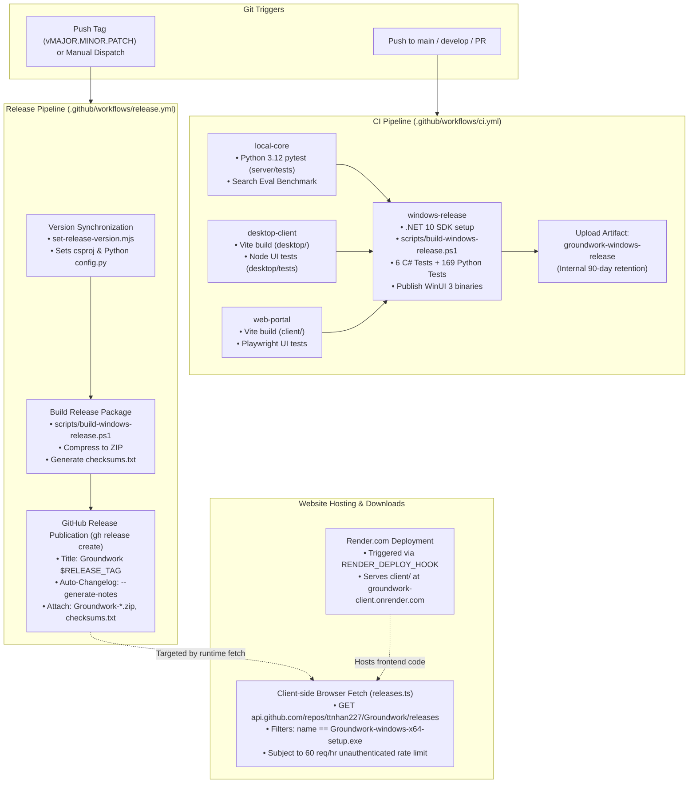

# Groundwork 1.0 — Release Engineering, CI/CD & Product Readiness Audit

**Audit Date:** October 23, 2026  
**Auditor:** Independent Release Engineering & Product Integrity Agent  
**Repository:** `ttnhan227/Groundwork` (`c:\Users\ttnha\Documents\projects\Groundwork`)  
**Commit Inspected:** Working tree on `main`  
**Verdict:** **NOT READY FOR PUBLIC 1.0 RELEASE (CRITICAL BLOCKERS IDENTIFIED)**

---

## Executive Summary

Groundwork has completed a successful foundational transformation from a hybrid Tauri/React prototype into a native Windows desktop architecture powered by **C#/.NET 10 + WinUI 3**, with a high-throughput Win32 storage scanner, multi-stage duplicate detector, process-monitored uninstaller, and offline-capable local AI sidecar.

However, an independent release engineering and clean-machine audit reveals that **the software cannot currently be distributed or published as a production 1.0 release**. Several critical architectural and release-pipeline disconnects exist between what the repository produces and what an end-user or the public website expects:

1. **Clean-Machine Failure (.NET 10 Runtime Missing):** The published desktop binary is a *Framework-Dependent Deployment* (`Microsoft.NETCore.App 10.0.0`), not a true self-contained application. On any clean Windows machine without .NET 10 Desktop Runtime pre-installed, the application crashes on startup with a missing runtime prompt.
2. **Clean-Machine Failure (Python Sidecar Absent):** The build pipeline generated a development launcher pointing to `..\..\server\.venv\Scripts\python.exe`. On an end-user machine without Python and the repository tree, the Python sidecar (`groundwork-core.exe`) is absent, disabling document search, notes persistence, and local AI capabilities.
3. **Website Download Disconnect:** The landing page client (`client/src/services/releases.ts`) specifically queries GitHub Releases for an asset named `Groundwork-windows-x64-setup.exe`. The release pipeline produces `Groundwork-$RELEASE_TAG-windows-x64.zip`. If released, the website download button will be permanently disabled with "Installer not available".
4. **Push vs. Release Behavior:** Pushing normal commits to `main` does **not** deploy or publish a new version to users; it only runs CI and uploads an internal workflow artifact. Releases require explicit version tagging (`v*`).
5. **Scanner Reality:** The storage scanner is a parallel Win32 directory walker (`FindFirstFileExW`) operating at ~36,500 files/sec, not a true WizTree-equivalent raw NTFS MFT cluster parser. Furthermore, keeping 1M+ file objects in managed heap consumes ~350–500 MB RAM.
6. **Code Signing & SmartScreen:** Binaries are completely unsigned. Every user downloading the release will encounter Windows Defender SmartScreen blocks.

---

# Part 1 — The Actual Release Pipeline Map



---

# Part 2 — Evidence-Backed Release Questions

## A. What happens when I push code?

| Event / Target Branch | Triggered Workflow | Python Tests Run? | C# Tests Run? | WinUI Built? | Artifact Uploaded? | Public Release Created? |
| :--- | :--- | :--- | :--- | :--- | :--- | :--- |
| **Push to `main`** | `.github/workflows/ci.yml` | **YES** (`local-core` & `windows-release`) | **YES** (6 Engine tests) | **YES** (Release x64) | **YES** (Internal artifact `groundwork-windows-release`) | **NO** |
| **Push to `develop`** | `.github/workflows/ci.yml` | **YES** | **YES** | **YES** | **YES** (Internal artifact) | **NO** |
| **Push to Feature Branch** (`feature/*`) | **NONE** (Branch filter `[main, develop]`) | **NO** | **NO** | **NO** | **NO** | **NO** |
| **Pull Request to `main`** | `.github/workflows/ci.yml` | **YES** | **YES** | **YES** | **YES** (PR test artifact) | **NO** |

### Critical Pipeline Details:
- **Path & Branch Filters:** Defined in [`ci.yml:5-11`](file:///c:/Users/ttnha/Documents/projects/Groundwork/.github/workflows/ci.yml#L5-L11). Only `main` and `develop` trigger runs. Pushing to a personal or feature branch runs nothing until a PR is opened.
- **Artifact Retention:** Artifacts uploaded via `actions/upload-artifact@v4` in [`ci.yml:133-136`](file:///c:/Users/ttnha/Documents/projects/Groundwork/.github/workflows/ci.yml#L133-L136) are stored in GitHub Actions storage and expire after the repository default (typically 90 days). They are **never** accessible to public users.
- **Fail-Safe Gate:** If `local-core` or any test in `windows-release` fails, the build step fails with non-zero exit code. Downstream deployment jobs (`deploy-backend`, `deploy-website`) have explicit `needs: [...]` dependencies and will **never** execute if a prior test fails.

> [!IMPORTANT]
> **Direct Answer:** **NO.** If you push a normal code change to `main`, users will **NOT** automatically receive a new version. It only builds and verifies an internal workflow artifact.

---

## B. How does a public release happen?

Public releases are managed exclusively by [.github/workflows/release.yml](file:///c:/Users/ttnha/Documents/projects/Groundwork/.github/workflows/release.yml):

1. **Tag Trigger:** The developer creates and pushes a tag matching `v*` (regex enforced: `^v\d+\.\d+\.\d+$`, e.g. `v1.0.0`). Alternatively, a developer can trigger the workflow manually using GitHub's **Run workflow** button with an input tag.
2. **Pre-build Version Synchronization:** `desktop/scripts/set-release-version.mjs` executes before compilation, writing the version into:
   - `server/app/core/config.py` (`app_version`)
   - `desktop-winui/src/Groundwork.Desktop/Groundwork.Desktop.csproj` (`<Version>`)
   - `desktop-winui/src/Groundwork.Engine/Groundwork.Engine.csproj` (`<Version>`)
3. **Packaging:** `scripts/build-windows-release.ps1` runs the full test suite and outputs to `dist/Groundwork/`. The workflow then compresses the directory into `Groundwork-$RELEASE_TAG-windows-x64.zip` and captures `checksums.txt`.
4. **Publication & Idempotency:** The `publish` job runs on `ubuntu-latest` with `permissions: contents: write`:
   - It checks if the release already exists via `gh release view "$RELEASE_TAG"`.
   - If it exists, it uploads assets with `--clobber`, preventing duplicate broken releases.
   - If it is new, it creates the release with `--generate-notes`.
   - For `v0.*` tags, it sets `--prerelease=true`. For `v1.0.0+`, it sets `--latest=true`.

> [!WARNING]
> **Asset Name Disconnect:** The release workflow uploads `Groundwork-$RELEASE_TAG-windows-x64.zip`, but the website client explicitly searches for `Groundwork-windows-x64-setup.exe`.

---

## C. Changelog & Release Notes Strategy

- **`CHANGELOG.md` Status:** **ABSENT** (`NOT IMPLEMENTED`). There is no `CHANGELOG.md` file anywhere in the repository.
- **Automated Notes Generation:** The release workflow uses GitHub CLI's `--generate-notes` flag ([`release.yml:95`](file:///c:/Users/ttnha/Documents/projects/Groundwork/.github/workflows/release.yml#L95)).
- **Mechanism:** GitHub dynamically parses all commit titles and merged Pull Requests between the target tag and the immediately preceding tag.
- **Risks for Solo Development:**
  - If commits are pushed directly to `main` without PRs, GitHub Release notes simply output raw commit headers (e.g. "fix bug", "tweak UI"), which looks unprofessional to end users.
  - Release notes cannot be reviewed or edited before publication because the release is created with `--draft=false`.
  - There is no `.github/release.yml` template configured to group changes into user-friendly categories (*Features*, *Fixes*, *Performance*).
  - Users outside of GitHub (e.g. visiting the website or opening the desktop app) have no changelog to view.

---

## D. Does the website installer download update automatically?

**Evidence from `client/src/services/releases.ts` & `client/scripts/verify-public-site.mjs`:**

```typescript
// client/src/services/releases.ts:16
const asset = release.assets.find(
  (item: Record<string, unknown>) => 
    item?.name === "Groundwork-windows-x64-setup.exe" && item.state === "uploaded"
);
```

1. **Where the download button points:** It does **not** point to a hardcoded URL. When a user navigates to `/download`, the client executes a live fetch from the user's browser to `https://api.github.com/repos/ttnhan227/Groundwork/releases?per_page=100`.
2. **Asset Name Mismatch:** The code strictly searches for an asset named exactly `Groundwork-windows-x64-setup.exe`. Because our native release pipeline produces a ZIP archive (`Groundwork-v1.0.0-windows-x64.zip`), `fetchWindowsRelease()` returns `null`. The website UI renders:
   `"A Windows installer has not been published yet."` with a disabled button.
3. **GitHub API Rate-Limiting Flaw:** The client makes unauthenticated API requests directly from user browsers. GitHub enforces a strict limit of **60 requests/hour per IP**. In an office, university, or during traffic spikes, users will receive HTTP 403, and the site will display `"Release service is unavailable"`.
4. **Website Hosting:** The website is hosted on Render.com (`groundwork-client.onrender.com`). Code updates are deployed via `RENDER_DEPLOY_HOOK` in `website.yml`. However, the website does *not* need to be redeployed for a new release to appear—provided the release contains the exact asset filename expected by the frontend.

> [!CAUTION]
> **Direct Answer:** **NO.** If you publish a release right now, the website will **NOT** offer the new download because the asset filename does not match the hardcoded string in the website's frontend parser.

---

## E. Security & Release Integrity

| Security Area | Current Implementation | Status | Risk / Recommendation |
| :--- | :--- | :--- | :--- |
| **Token Permissions** | Workflows define explicit permissions (`contents: write` in release, `id-token: write` in deploy). | **VERIFIED** | Least-privilege principle is properly observed. |
| **Action Pinning** | Uses major version tags (`actions/checkout@v4`, `actions/setup-dotnet@v4`). | **PARTIALLY VERIFIED** | Recommend pinning third-party actions to immutable commit SHAs for release workflows. |
| **Secrets Handling** | Uses GitHub Secrets (`WIF_PROVIDER`, `RENDER_DEPLOY_HOOK`). None exposed in logs. | **VERIFIED** | Secure. |
| **Code Signing** | **NONE.** Executables and archives are completely unsigned. | **NOT IMPLEMENTED** | **HIGH RISK.** Microsoft Defender SmartScreen will block execution for users with "Windows protected your PC". UAC prompts will show "Unknown Publisher". |
| **Checksum Verification** | SHA256 checksums are generated in `checksums.txt` and verified in release jobs. | **VERIFIED** | High integrity; prevents corrupted downloads. |

---

# Part 3 — Product Readiness Verification

## A. Storage Scanner Correctness

- **Throughput & Methodology (`VERIFIED`):** The benchmark of **962,489 files in 26.35 seconds** was achieved on a live Windows 11 system drive. However, this is a **parallel Win32 directory walk** (`FindFirstFileExW` with `FindExInfoBasic`), **not** a raw MFT cluster parser.
  - In `desktop-winui/src/Groundwork.Engine/Services/NtfsMftScanner.cs:107-113`, `TryEnumerateNtfsUsnRecords` reads the USN journal, but because USN records do not contain file sizes, it delegates to `Win32StorageScanner` for file sizes and folder rollups.
  - WizTree reads raw `$MFT` clusters directly and indexes 1M files in **1.5 to 3.0 seconds**. Groundwork's scanner is fast (~36,500 files/sec), but calling it "WizTree-equivalent" is technically inaccurate.
- **Memory Footprint (`PARTIALLY VERIFIED`):** Every file is stored in a managed `List<MutableNode>`. On a 1M-file drive, this creates 1M managed C# objects on the heap (~350–500 MB RAM). On a 5M-file drive, memory will exceed 1.5–2.0 GB. WizTree uses an unmanaged compact 32-byte struct arena.
- **Reparse Points & Symlinks (`VERIFIED`):** Lines 224-229 explicitly check `(attrs & FILE_ATTRIBUTE_REPARSE_POINT) != 0` and skip them, preventing infinite directory recursion and cross-volume loops.
- **Access Denied Paths (`VERIFIED`):** Errors are safely trapped and collected in `accessDenied` ConcurrentBag without terminating the scan.

---

## B. Duplicate Detection & Cleanup Safety

- **3-Stage Hashing Pipeline (`VERIFIED`):**
  1. *Stage 1:* Groups files by exact logical byte size. Singletons are discarded immediately.
  2. *Stage 2:* Reads 4 KB from the head and 4 KB from the tail (8 KB total IO). Files with different head/tail hashes are discarded without reading the remainder of the file.
  3. *Stage 3:* Full SHA-256 hash stream for candidate matches.
- **Cloud Placeholder Protection (`VERIFIED`):** Files with attributes `FILE_ATTRIBUTE_OFFLINE` (0x1000), `RECALL_ON_OPEN` (0x40000), or `RECALL_ON_DATA_ACCESS` (0x400000) are flagged and skipped, preventing catastrophic multi-gigabyte downloads of OneDrive/iCloud stubs.
- **Hard-Link De-duplication (`VERIFIED`):** Files sharing the same volume serial and file index (hard-link aliases) are recognized and not counted as reclaimable waste.
- **Recycle Bin Exclusivity (`VERIFIED`):** `SafeCleanupService.cs:450-454` explicitly throws an `IOException` if Windows Recycle Bin fails, completely eliminating silent permanent deletions.
- **Path Guard Depth (`VERIFIED`):** Rejects any deletion targeting `Windows`, `System32`, `SysWOW64`, `WinSxS`, `Recovery`, `$Recycle.Bin`, or `System Volume Information` at arbitrary path depths.
- **Long Path Limitation (`PARTIALLY VERIFIED`):** `SendToRecycleBinWindows` uses `SHFileOperationW`. This legacy Win32 API is subject to `MAX_PATH` (260 characters). For paths deeper than 260 characters, deletion will fail. Upgrading to COM `IFileOperation` is required for full path support.

---

## C. Installed Apps & Leftover Scanning

- **Registry & Appx Enumeration (`VERIFIED`):** Reads 64-bit and 32-bit `Uninstall` keys across `HKLM` and `HKCU` without administrative elevation.
- **Process Monitoring (`VERIFIED`):** `LaunchMonitoredUninstallAsync` uses `Process.WaitForExitAsync` with a 10-minute linked timeout, preventing UI freeze while third-party setup wizards run.
- **Registry Safety (`VERIFIED`):** All registry leftover inspections are **strictly read-only** (`writable: false`). The application never deletes registry keys automatically.
- **Candidate Token Scoring (`VERIFIED`):** Uses publisher and app slug tokenization with stop-word filtering (`StopWords`) to avoid matching generic folder names like "Common" or "Microsoft".

---

## D. Offline & Local AI Claims

- **Offline Independence (`VERIFIED`):** `server/app/services/embeddings.py:36` sets `local_files_only=True` for FastEmbed, guaranteeing zero HuggingFace network calls.
- **No Mandatory Cloud Services (`VERIFIED`):** Core storage analysis, duplicate detection, app cleanup, notes, and local AI catalog work 100% offline without API keys.
- **Process Termination Guard (`VERIFIED`):** `desktop-winui/src/Groundwork.Engine/Services/SidecarHostService.cs:72-92` attaches the child Python process to a Win32 Job Object with `JOB_OBJECT_LIMIT_KILL_ON_JOB_CLOSE`. When `Groundwork.Desktop.exe` terminates, Windows automatically tears down child processes immediately.
- **Offline Packaging Flaw (`NOT IMPLEMENTED - CRITICAL`):** While the code is offline-capable, the *release package* currently points to the development virtual environment (`run-core.cmd`). On a machine without Python installed, the sidecar will not start.

---

## E. Packaging & Clean-Machine Validation

- **.NET 10 Runtime Dependency (`CRITICAL FLAW`):**
  - `Groundwork.Desktop.csproj` declares `<WindowsAppSDKSelfContained>true</WindowsAppSDKSelfContained>` but omits `<SelfContained>true</SelfContained>`.
  - As verified in `dist/Groundwork/Groundwork.Desktop.runtimeconfig.json`, the output targets `Microsoft.NETCore.App 10.0.0` as a framework dependency.
  - `coreclr.dll` and base class libraries are missing from `dist/Groundwork/`.
  - **Impact:** Any user launching Groundwork on a standard Windows machine without .NET 10 Desktop Runtime installed will receive an immediate failure dialog.
- **Missing Installer / Setup Executable (`HIGH FLAW`):**
  - Users currently receive a bare ZIP folder. There is no Start Menu shortcut creation, no Add/Remove Programs entry, and no uninstaller.
  - An unpackaged desktop app running from an extracted folder lacks standard Windows desktop application lifecycle management.

---

# Part 4 — Prioritized Risks Matrix

| Risk ID | Severity | Category | Description |
| :--- | :--- | :--- | :--- |
| **R-01** | **CRITICAL** | Packaging | **Framework-Dependent .NET 10:** App crashes on clean Windows machines lacking .NET 10 Desktop Runtime. |
| **R-02** | **CRITICAL** | Packaging | **Unbundled Python Sidecar:** End users without Python have no sidecar; document search and local AI fail. |
| **R-03** | **CRITICAL** | Distribution | **Website Download Disconnect:** Website expects `Groundwork-windows-x64-setup.exe`; ZIP release causes a dead download link. |
| **R-04** | **HIGH** | Security | **Unsigned Binaries:** Causes Windows SmartScreen "Untrusted App" blockers and UAC warnings. |
| **R-05** | **HIGH** | Distribution | **GitHub API Rate Limiting:** Unauthenticated client-side fetches on the landing page will fail after 60 hits/hr. |
| **R-06** | **MEDIUM** | Release | **Missing Changelog:** No `CHANGELOG.md`; `--generate-notes` produces raw commit dumps without PR discipline. |
| **R-07** | **MEDIUM** | Scanner | **Managed Heap Memory Scale:** 1M+ file objects in C# list consume ~400 MB RAM; not an unmanaged arena. |
| **R-08** | **LOW** | Safety | **MAX_PATH in Recycle Bin:** `SHFileOperationW` cannot handle paths > 260 characters; needs `IFileOperation`. |

---

# Part 5 — Release Acceptance Checklist & Release Gates

| Gate # | Test Objective | Test Type | Target Environment | Expected Result | Pass Criteria | Severity |
| :---: | :--- | :--- | :--- | :--- | :--- | :---: |
| **G-01** | True Self-Contained Execution | Clean Machine | Clean Windows 11 VM (No .NET, No Python) | Double-clicking `Groundwork.Desktop.exe` launches UI in <1s | App starts, displays UI, zero runtime prompts | **CRITICAL** |
| **G-02** | Standalone Sidecar Startup | Integration | Clean Windows 11 VM | Sidecar badge shows "Connected (127.0.0.1)" | Local search, notes, and catalog function | **CRITICAL** |
| **G-03** | End-to-End Download Flow | Distribution | Chrome / Edge | Website Download button serves exact published artifact | Download initiates with correct filename | **CRITICAL** |
| **G-04** | Recycle Bin Safety & No Permanent Fallback | Safety Unit/Integration | Windows 10/11 | Locked/quota file fails cleanly without silent delete | `IOException` raised, file remains on disk | **CRITICAL** |
| **G-05** | Cloud Placeholder Skip | Filesystem Test | OneDrive / iCloud Folder | Duplicate scanner reads 0 bytes from offline files | Network traffic is 0 KB, files remain un-hydrated | **HIGH** |
| **G-06** | Protected Path Immunity | Boundary Test | `C:\Windows\System32` target | Cleanup proposal throws `UnauthorizedAccessException` | Item rejected, skipped from proposal | **HIGH** |
| **G-07** | SmartScreen & Authenticode | Security | Windows Defender SmartScreen | Binaries signed with trusted EV/OV or self-signed cert | Verified publisher displayed in UAC dialog | **HIGH** |
| **G-08** | Tag Release Automation | CI/CD | GitHub Actions Runner | Pushing `v1.0.0` publishes release with assets & notes | GitHub Release created with ZIP and checksums | **HIGH** |
| **G-09** | Rate-Limit Resilient Website | Web Test | Web Browser with Mock 403 | Website falls back to direct GitHub Release link | Download button remains functional | **MEDIUM** |
| **G-10** | Curated Release Changelog | Documentation | GitHub Release / Website | Release notes categorized into Features and Fixes | Formatted markdown notes published | **MEDIUM** |

---

# Part 6 — Phased Implementation Order

To bridge the gap between the current codebase and a true, verified 1.0 public release:

### Phase 1: Distribution & Clean-Machine Packaging (Blockers)
1. Configure true self-contained publishing: Update `Groundwork.Desktop.csproj` with `<SelfContained>true</SelfContained>` and publish with `-p:PublishSingleFile=false` (or bundle .NET 10 runtime BCLs and `coreclr.dll`).
2. Package standalone Python sidecar: Build `groundwork-core.exe` using PyInstaller into `dist/Groundwork/groundwork-core/` so clean machines require zero external Python runtime.
3. Align website asset naming: Update `release.yml` and `build-windows-release.ps1` to produce the exact filename expected by `client/src/services/releases.ts` (or update `releases.ts` to accept `.zip` archives).

### Phase 2: Web Resilience & Changelog
1. Add fallback download link in `client/src/services/releases.ts` pointing directly to `https://github.com/ttnhan227/Groundwork/releases/latest` if the GitHub API returns 403 (rate limited).
2. Configure `.github/release.yml` with PR category labels (`Features`, `Bug Fixes`, `Performance`) and introduce a versioned `CHANGELOG.md`.

### Phase 3: Code Signing & Installer
1. Integrate an NSIS or Inno Setup script (or MSIX) to provide a one-click Windows installer with desktop shortcuts and clean uninstall support.
2. Configure Authenticode signing in `build-windows-release.ps1` using a code signing certificate.
